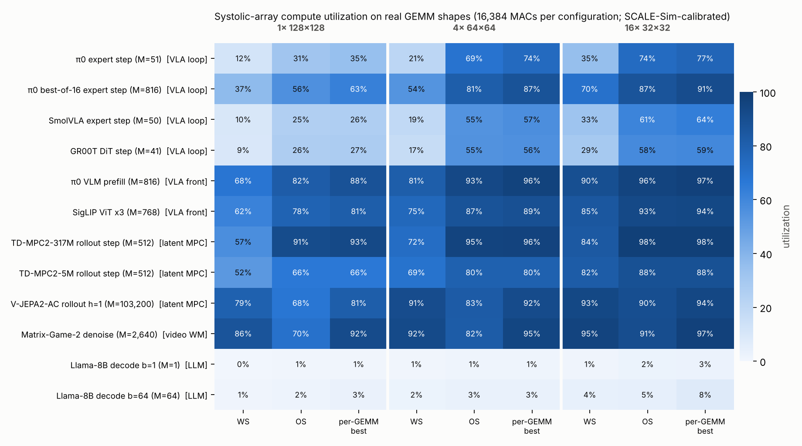
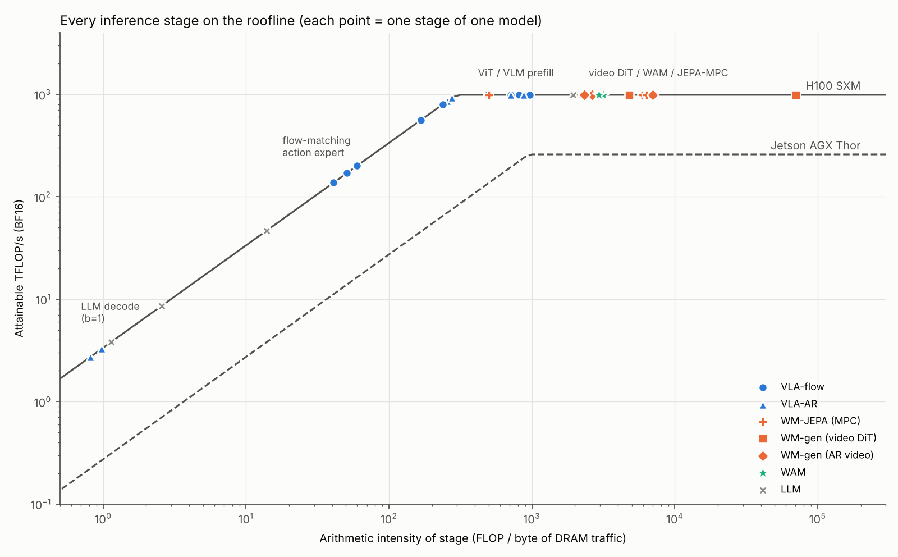

# World Model / VLA / WAM 推論分析：資料流、記憶體 I/O、計算負載，以及與 LLM 的本質差異

> 目標：為 **world model 推論加速器（ASIC）** 的設計找出關鍵。
> 方法：從 11 個開源模型的**原始碼**（DreamZero 以論文為準）讀出架構，建立可重跑的解析模型，計算每個推論階段的 FLOPs、DRAM 流量、算術強度與 roofline 延遲，並與 LLM 對照。
> 日期：2026-10-12

## 涵蓋的模型

| 類別 | 模型 | 開源 repo |
|---|---|---|
| VLA（flow-matching） | **π0、π0.5**、**SmolVLA**、**GR00T N1.7** | openpi、lerobot、Isaac-GR00T |
| VLA（自回歸） | **OpenVLA**、**π0-FAST** | openvla、openpi |
| 世界模型（JEPA + MPC） | **V-JEPA 2-AC** | vjepa2 |
| 世界模型（影片擴散） | **Cosmos-Predict2.5**、**Matrix-Game 2.0 / 3.0** | cosmos-predict2.5、Matrix-Game |
| World Action Model | **DreamZero**（Wan2.1-14B backbone） | 論文 arXiv:2602.15922 |
| LLM 對照組 | Llama-3.1-8B（decode / prefill） | – |

## 七個關鍵發現

**1. VLA 的瓶頸是「重複讀小模型的權重」，不是算力。**
π0 的 action expert 只佔 **9% FLOPs**，卻佔 Jetson AGX Thor 上 **56% 的延遲**：它用 M = 51 的 GEMM 跑 10 步，每步重讀 622 MB 權重，算術強度只有 ~60 FLOP/B。GR00T（DiT 21% FLOPs → 64% 延遲）、SmolVLA（12% → 67%）都一樣。

**2. 這些「迴圈權重」小到可以考慮放進片上 SRAM。**
FP8 下 SmolVLA expert 97 MB、π0 expert 311 MB、GR00T DiT 415 MB（FP4 再減半）。若常駐片上，π0 跑 10 步只比 1 步多 3%（41.9 → 21.3 ms）。LLM 的 15 GB 權重不可能做到這點。
（修訂：256 MB SRAM 在 N5 級約 70–90 mm²，是需要權衡的選項而非預設；若系統本來就做 best-of-K 候選，權重讀取會被攤提，常駐需求隨之消失。見 [08 §8.4](docs/08-cross-review-with-gpt.md)。）

**3. VLA 的 KV cache 小、固定、用完即丟。**
GR00T 0.7 MB、SmolVLA 4.9 MB、π0 15 MB（MQA），對比 Llama-3.1-8B 在 128K context 的 17 GB。不需要 PagedAttention、offload 或任何 LLM 式 KV 管理。

**4. 自回歸 VLA 就是 LLM decode。**
π0-FAST / OpenVLA 的 decode 階段算術強度 ≈ 1 FLOP/B，π0-FAST 在 Thor 上比 π0 慢 **27 倍**；每個動作 token 還要讀一個為 25 萬詞設計的輸出層。

**5. 影片世界模型是相反的極端：算力 + 注意力 + activation 瓶頸。**
算術強度 2,500–70,000 FLOP/B；注意力佔 FLOPs 24–83%；Cosmos 720p 的 DRAM 流量 83% 是 activation；Matrix-Game 2.0 需要 ~1 GB 滑動視窗 KV cache；世界模型還附帶一個 3D 卷積 VAE。

**6. WAM 在 2026 年仍是資料中心工作負載。**
DreamZero 級（14B、7 Hz）即使 1 步取樣也需要 ~1.5 PFLOP/s 持續算力。最有效的槓桿依序是：latent 壓縮率（token 數）> 步數蒸餾 > 低精度 > 注意力稀疏。

**7. 三者落在 roofline 的三個位置。**
LLM decode（AI ≈ 1）、VLA 迴圈（AI ≈ 50）、影片 DiT（AI > 2,500）。一顆同時服務 VLA 與世界模型的晶片，必須同時處理頻寬瓶頸與算力瓶頸。
（修訂：瓶頸是「階段 × 硬體」的組合而非模型類別的屬性——同一個 VLM prefill 在 H100 上算力受限、在 Thor 上頻寬受限。見 [08 §8.4](docs/08-cross-review-with-gpt.md)。）

## 第三輪：週期級陣列模擬（2026-10-12）

同樣 16,384 個 MAC：TPU 式 128×128 weight-stationary 陣列跑 VLA 動作迴圈（M=41–51）只有 **9–12%** 利用率；16 × 32×32 + 每個 GEMM 選 dataflow 有 59–77%，且對影片 DiT / latent MPC / prefill 仍有 88–98%。權重常駐片上只有搭配小陣列才有效（Thor 等級晶片上 π0 chunk 38.0 → 22.9 ms）。校準：30 個 SCALE-Sim 案例，誤差 < 0.01%。見 [09](docs/09-systolic-simulation-and-experiments.md)。



## 第二輪：LLM 加速器技巧的可移植性（2026-10-12）

把 2026 年以前約 60 項 LLM / 擴散模型加速論文與技巧寫成分析模型上的變換，套到 12 個 workload：

- **低精度是唯一對所有類別都有效的技巧**（FP8 2×、FP4 2.6–4×）。
- **LLM serving 的招牌技巧（PagedAttention、continuous batching、KV 量化、PIM attention）對 VLA 幾乎無效**（1.00–1.01×）。
- **權重頻寬技巧對 VLA 有效，對影片世界模型無效**；影片世界模型要靠擴散模型的步數蒸餾與跨步重用（Cambricon-D、EXION、TeaCache）。
- **與 GPT 研究的交會**：flow VLA 的頻寬瓶頸讓「policy 產生多個候選、world model 評分」幾乎免費——Thor 上 16 個候選只比 1 個多 25% 時間。




## 文件導覽

| 章節 | 內容 |
|---|---|
| [00 · 方法論與假設](docs/00-methodology.md) | 分析模型公式、硬體參數、限制 |
| [01 · 模型目錄](docs/01-model-catalog.md) | 12 個模型的架構與推論流程（附原始碼路徑）、參數量驗證 |
| [02 · 資料流](docs/02-dataflow.md) | 軟體層五種資料流型態、硬體層每階段 DRAM ↔ SRAM ↔ 運算的搬運 |
| [03 · 記憶體 I/O](docs/03-memory-io.md) | 權重 / KV / activation / 常駐狀態的量化比較 |
| [04 · 計算負載](docs/04-compute-loading.md) | FLOPs、算術強度、注意力佔比、即時性、步數敏感度 |
| [05 · 與 LLM 的本質差異](docs/05-vs-llm.md) | 十個層面：任務、生成範式、輸入、記憶、時間、批次、計算、數值、系統、目標 |
| [06 · 對 ASIC 設計的含義](docs/06-asic-implications.md) | 七條設計結論與一份邊緣晶片粗略規格 |
| [07 · LLM 加速器論文與技巧的可用性](docs/07-llm-accelerator-techniques.md) | 硬體論文（transformer/低精度/PIM/SRAM-first/擴散加速器）與軟體技巧目錄，量化每個技巧對每類模型的效果 |
| [08 · 與 GPT 研究的交叉審查](docs/08-cross-review-with-gpt.md) | 一致處、以真實模型代入 GPT 公式、回應 GPT 的保留並修正本資料夾的說法 |
| [09 · 週期級陣列模擬與實驗套件](docs/09-systolic-simulation-and-experiments.md) | SCALE-Sim 校準的陣列利用率、陣列形狀 × dataflow × 權重常駐、E1–E3 實驗套件與 Colab notebook |
| [reviews · 回覆 GPT 審查請求](reviews/pre2026-llm-acceleration-review.md) | SpAtten / DFX / FlightLLM / NeuPIMs / AttAcc 的驗證層級、對 latent MPC 的可移植性、三個可驗證實驗 |
| [references](docs/references.md) | 原始碼版本、論文 |

## 數據與圖表

| 檔案 | 內容 |
|---|---|
| [`results/results.md`](results/results.md) | 每個 workload 的總量與每個階段的分解（自動產生） |
| [`results/sensitivity.md`](results/sensitivity.md) | 精度、步數、context 長度、SRAM 容量的敏感度 |
| [`results/techniques.md`](results/techniques.md) | 每個加速技巧在每個 workload 上的 roofline 加速倍數（Thor / H100） |
| [`results/decision_system.md`](results/decision_system.md) | GPT 公式的真實模型代入（V-JEPA 2-AC、TD-MPC2）；policy 候選 + world model 評分的成本 |
| [`results/systolic.md`](results/systolic.md)、[`results/scalesim_validation.csv`](results/scalesim_validation.csv) | 陣列利用率（週期級模擬）與 SCALE-Sim 校準資料 |
| [`experiments/`](experiments/README.md) | 可執行的 E1–E3 實驗套件與 [Colab notebook](https://colab.research.google.com/github/MaSuo1032/world-model-asic-reasearch/blob/main/CLAUDE/experiments/colab_experiments.ipynb) |
| [`results/summary.csv`](results/summary.csv)、[`results/stages.csv`](results/stages.csv) | 機器可讀版本 |
| [`figures/`](figures/) | roofline、流量組成、延遲 vs 預算、常駐狀態、步數 vs SRAM、技巧熱圖 |

## 重現

```bash
pip install matplotlib
python analysis/run_all.py      # results/*.md, *.csv, figures/*.png
python analysis/sensitivity.py  # results/sensitivity.md, figures/pi0_steps_sram.png
python analysis/techniques.py   # results/techniques.md, figures/techniques_heatmap_*.png
python analysis/decision_system.py  # results/decision_system.md
python analysis/systolic.py         # results/systolic.md, figures/systolic_utilization.png
python analysis/scalesim_validate.py  # (slow, optional) re-run SCALE-Sim calibration
```

模型與 workload 定義在 [`analysis/models.py`](analysis/models.py)，假設值以 `# ASSUMPTION` 標註；改完重跑即可。

## 重要限制

- 延遲是**理想 roofline 下限**；「實際約 ×1.5–4」是未經本研究量測的經驗範圍；小 M GEMM 的真實利用率更差，所以「VLA 迴圈受頻寬限制」的結論在真實硬體上只會更明顯。
- Jetson AGX Thor / Orin 的 BF16 峰值是由官方稀疏低精度數字推導的估計值。
- DreamZero 的片段大小、Matrix-Game 3.0 的片段組成與 DiT 規格為假設（程式碼內 config 與 README 敘述不一致，詳見 [01 §8](docs/01-model-catalog.md)）。
- 未模擬 VAE、文字編碼器、前處理與主機傳輸。
