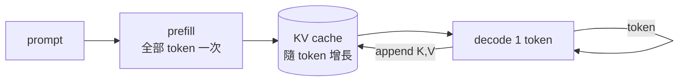
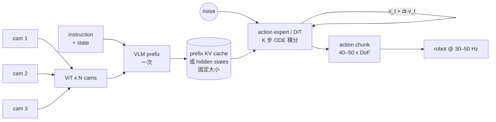
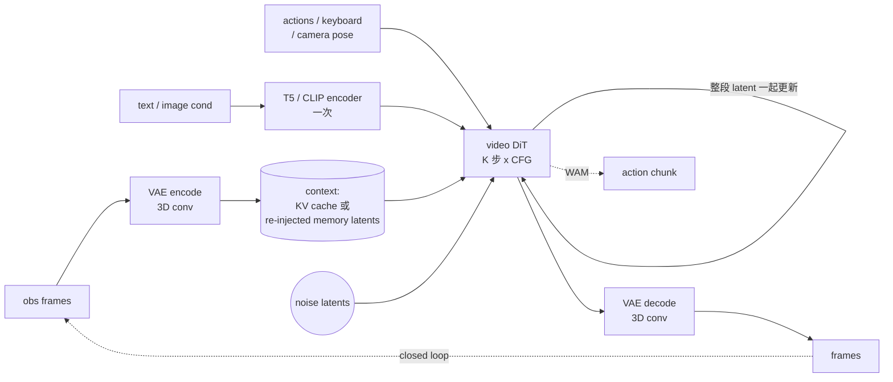
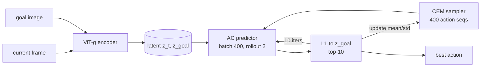
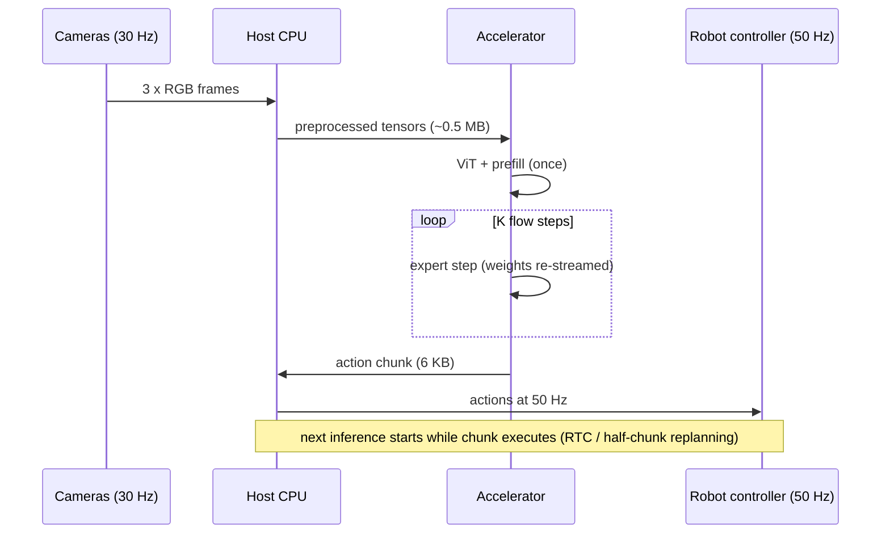

# 02 · 軟體與硬體層的資料流

本章分兩層看資料怎麼流：**軟體層**（一次推論由哪些階段組成、誰依賴誰、什麼被快取）和**硬體層**（每個階段的資料在 DRAM ↔ SRAM ↔ 運算單元之間怎麼搬）。

---

## 2.1 軟體層：四種資料流型態

### (A) LLM decode —— 單一迴圈、狀態隨時間增長



- 一個模型、一個迴圈，每圈產出 1 個 token、權重全讀一次、KV cache 長 1 格。
- 沒有時間截止點，追求的是吞吐量（tokens/s/$），可以把很多使用者 batch 在一起。

### (B) VLA-flow（π0 / π0.5 / SmolVLA / GR00T）—— 「重前段 + 輕迴圈」



- **前段**（ViT + VLM prefill）每次推論做一次，M 維數百～上千，計算密集。
- **迴圈**（action expert）做 K 次（π0：10、GR00T：4），每次 M 只有 40–51，讀同一份 expert 權重和同一份 prefix KV。
- 迴圈之間**只有 50×32 個浮點數**（動作 latent）在流動——資料量極小，但權重每圈都要重讀。
- 前段的 KV cache **大小由感測器組態決定**（相機數 × 每圖 token + 文字），不隨時間長大；每次重新規劃就整個丟掉重算。
- 輸出（action chunk）和控制迴圈是**兩種頻率**：模型以 2–10 Hz 產生 chunk，機器人以 30–50 Hz 執行。π0 的 real-time chunking（RTC）或 GR00T 的半 chunk 重規劃都在處理這個時間錯位。

### (C) VLA-AR（OpenVLA / π0-FAST）—— 「VLM + 一小段 LLM decode」

和 (A) 相同的結構，只是 decode 長度固定（7 或 ~60 token）且之後整個 cache 丟棄。資料流特性完全等同 LLM decode：**每個 token 讀全部權重 + 詞表輸出層**。

### (D) 影片世界模型 / WAM —— 「所有 token 一起反覆去噪」



- 每一步都處理**整段影片的全部 token**（數千到七萬），所以 M 很大、注意力是 N²。
- 三種「記憶」機制並存：
  - **Cosmos**：一次生成整段（雙向注意力），沒有跨段狀態。
  - **Matrix-Game 2.0 / DreamZero**：自回歸逐段生成，**KV cache 跨段保存**（滑動視窗 6 個 latent 幀 ≈ 1 GB；DreamZero 估計 ≈ 7.7 GB）。
  - **Matrix-Game 3.0**：依相機視野挑選歷史 latent 幀，**重新注入為輸入 token**（以算力換記憶體）。
- 前後各有一個 **3D 卷積 VAE**：這是 Transformer 以外的大型工作負載，Matrix-Game 3.0 甚至另開一個 `vae_worker` 行程做 pipeline 平行，並把 VAE decoder 剪枝 50%（`--lightvae_pruning_rate 0.5`）才達到 40 FPS。
- **WAM（DreamZero）** 在同一個 DiT 裡同時去噪影片 latent 和動作 token；動作只多幾十個 token，計算量幾乎全在影片上。執行完動作後，用真實觀測覆寫 KV cache 中的預測幀。

### (E) JEPA + MPC（V-JEPA 2-AC）—— 「在潛在空間裡大量平行想像」



- Encoder 只跑 2 張圖；計算的 98% 在 predictor，且 400 條候選軌跡**完全平行**。
- 這是唯一一個「可以用 batch 撐滿硬體」的機器人推論流程。

---

## 2.2 硬體層：每個階段的資料怎麼搬

以下用一個「DRAM → 片上 SRAM/快取 → 矩陣單元」的抽象機器來描述。核心問題永遠是：**每從 DRAM 搬一個 byte，能做多少次乘加**（算術強度，AI）。

### 階段一：感測器輸入與前處理

| 資料 | π0（3 cam） | Matrix-Game 3.0 | LLM |
|---|---|---|---|
| 每次推論的原始輸入 | 3 × 224² × 3 B ≈ **452 KB** | 前一段 latent（數 MB） | 幾十個 token id（< 1 KB） |
| 前處理 | resize、normalize、patchify（CPU 或 ISP） | VAE encode（3D conv） | tokenizer（CPU） |

機器人模型的輸入是**持續的、多路的、高頻寬的感測器串流**，而 LLM 的輸入幾乎可忽略。這段在 GPU 系統上常走 CPU → PCIe → GPU，邊緣 SoC 則可能直接從 ISP 進 DRAM。

### 階段二：ViT（視覺編碼）

- 每張圖 256–1024 token，各圖獨立 → 多相機可 batch，**權重讀一次服務 768+ 個 token**，AI ≈ 700 FLOP/B（π0）。
- H100 上計算密集；在 Thor（ridge 點 ≈ 950 FLOP/B）上反而剛好在 memory/compute 邊界。
- 資料流：權重串流（411 MB BF16）+ 每層的 patch activation（768 × 1152 × 2 B ≈ 1.8 MB，可以留在 SRAM）。

### 階段三：VLM prefill

- M = 168（GR00T）～ 968（π0.5）。權重 1.2–4 GB 讀一次。
- 產物：
  - π0：MQA 的 KV cache，**15 MB**，寫回 DRAM，迴圈中被讀 10 次。
  - GR00T：只有第 12 層 hidden state，**0.7 MB**，可以整個留在片上。
  - SmolVLA：16 層的 KV（5 KV heads × 64），**4.9 MB**。

### 階段四：動作迴圈（VLA 的效能關鍵）

每一步的資料搬運：

```
DRAM ──(expert weights 622 MB BF16)──► 矩陣單元   ← 每步一次，佔流量 97%
DRAM ──(prefix KV 15 MB)───────────► attention    ← 每步一次
SRAM ◄──► (51 tokens × 1024 × 2 B = 104 KB activation) ← 完全放得進片上
```

- GEMM 形狀是 **[51 × 1024] × [1024 × 4096]**：每讀一個權重 byte 只做約 51 次乘加，AI ≈ 50–60 FLOP/B，比任何硬體的 ridge 點都低 → **記憶體頻寬瓶頸**。
- 10 步重複讀**同一份**權重。如果權重能常駐片上（FP8 時 311 MB），迴圈就從頻寬瓶頸變成算力瓶頸——見 [03](03-memory-io.md)、[06](06-asic-implications.md)。

### 階段五：影片 DiT 去噪迴圈

- M = 2,640（Matrix-Game 2.0）～ 70,400（Cosmos 720p）。權重每步讀一次，但被數千 token 攤提 → AI 2,500–70,000 FLOP/B，**算力瓶頸**。
- 真正的記憶體壓力來自兩處：
  1. **注意力的 K/V**：Matrix-Game 2.0 每一層要讀 5,280 個 token 的 K/V（視窗內），整段 KV cache 973 MB，每步全讀。
  2. **activation**：Cosmos 720p 一層的 activation 是 70,400 × 2048 × 2 B ≈ 288 MB，無法放進任何 SRAM，必須在層與層之間進出 DRAM（這就是 Cosmos 720p 流量中 83% 是 activation 的原因）。
- FlashAttention 類演算法讓 N² 的分數矩陣不必落地，但 Q/K/V tile 仍要從 DRAM 反覆串流。

### 階段六：VAE decode 與輸出

- 3D causal conv，通道數數百、空間解析度逐步放大，activation footprint 隨解析度平方成長。
- 這是**卷積**工作負載，對以 GEMM 為中心的加速器（或 Transformer 專用 ASIC）不友善；Matrix-Game 3.0 用蒸餾 + 剪枝的輕量 VAE、獨立行程處理。
- 輸出資料量：12 幀 720p RGB ≈ 33 MB，對比 VLA 輸出的 50 × 32 × 4 B = 6.4 KB。

---

## 2.3 主機 / 加速器 / 機器人的系統資料流



與 LLM serving 最大的不同在於：**有硬性的截止時間**（下一段 chunk 必須在當前 chunk 用完前到達），而且**通常只有一個使用者（batch = 1）**——沒有其他請求可以拿來 batch、攤提權重讀取。
