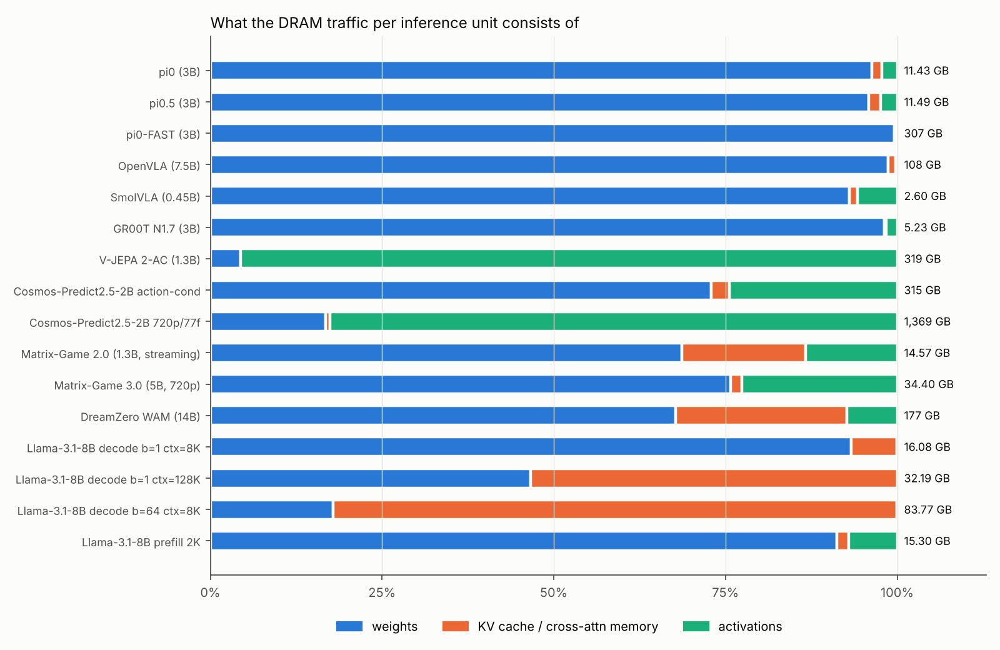
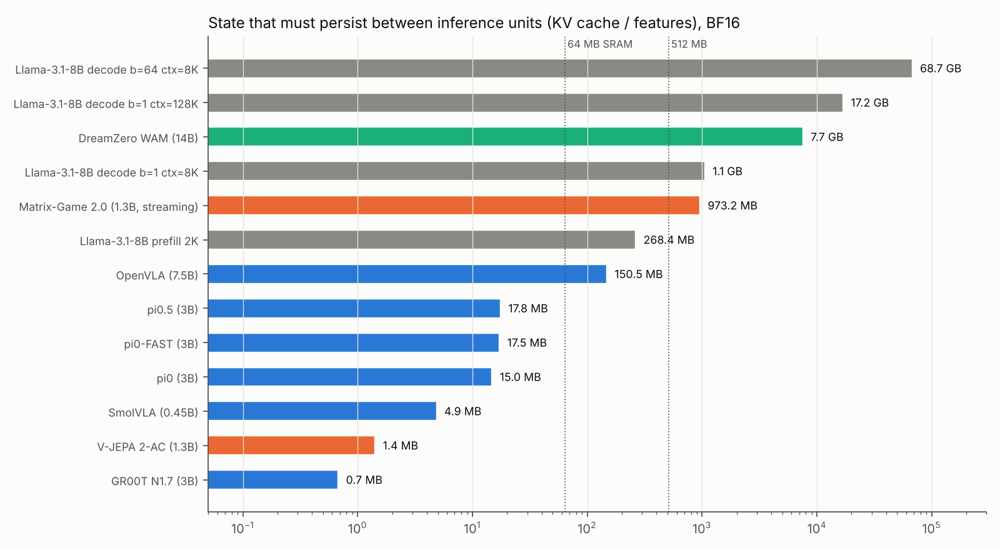

# 03 · 記憶體 I/O：權重、KV、activation、常駐狀態

所有數字由 `analysis/run_all.py` 產生（BF16 權重與 activation），完整表格見 [`results/results.md`](../results/results.md)。

---

## 3.1 每個推論單位搬多少資料

| Workload | 單位 | 權重 GB | KV/ctx GB | Activation GB | 合計 GB | 權重佔比 |
|---|---|---|---|---|---|---|
| π0 | 50 步 chunk | 11.0 | 0.17 | 0.25 | 11.4 | **96%** |
| π0.5 | 50 步 chunk | 11.0 | 0.20 | 0.28 | 11.5 | 96% |
| SmolVLA | 50 步 chunk | 2.4 | 0.03 | 0.15 | 2.6 | 93% |
| GR00T N1.7 | 40 步 chunk | 5.1 | 0.02 | 0.08 | 5.2 | 98% |
| π0-FAST | ~60 token chunk | 305.8 | 1.03 | 0.24 | 307 | **100%** |
| OpenVLA | 1 個動作 | 106.9 | 1.19 | 0.21 | 108 | 99% |
| V-JEPA 2-AC | 1 個規劃動作 | 14.1 | 0 | 304.5 | 319 | 4% |
| Cosmos-2.5-2B action-cond | 12 幀 | 230.2 | 8.2 | 77.1 | 315 | 73% |
| Cosmos-2.5-2B 720p/77f | 77 幀 | 230.2 | 8.2 | 1,130 | 1,369 | 17% |
| Matrix-Game 2.0 | 12 幀 | 10.0 | 2.6 | 2.0 | 14.6 | 69% |
| Matrix-Game 3.0 | 16 幀 | 26.1 | 0.6 | 7.8 | 34.4 | 76% |
| DreamZero | 1 段動作 | 119.5 | 44.1 | 12.9 | 177 | 68% |
| Llama-3.1-8B decode b=1, 8K | 1 token | 15.0 | 1.1 | ~0 | 16.1 | 93% |
| Llama-3.1-8B decode b=1, 128K | 1 token | 15.0 | 17.2 | ~0 | 32.2 | 47% |
| Llama-3.1-8B decode b=64, 8K | 64 token | 15.0 | 68.7 | ~0 | 83.8 | 18% |

## 3.2 三個觀察

### 觀察 1：VLA 的流量幾乎全是「重複讀同一份權重」

π0 一個 chunk 讀 11 GB，但模型本身只有 5.4 GB（BF16）——**多出來的 6.2 GB 是 action expert 的 622 MB 權重被讀了 10 次**。

這跟 LLM decode 的「每個 token 讀一次全部權重」本質相同，差別在於：

| | LLM decode | VLA flow 迴圈 |
|---|---|---|
| 重讀的原因 | 自回歸：下一個 token 依賴上一個 | ODE 積分：下一步依賴上一步的 x_t |
| 每次重讀服務的 token 數（M） | 1（b=1）～ batch 大小 | 40–51（固定，由 chunk 長度決定） |
| 重讀的權重大小 | 全部（7–70 B 參數） | 只有 expert（98–466 M 參數） |
| 能否 batch 掉 | 可以：多使用者並行 | 很難：通常單機器人、單請求 |
| 重讀次數 | 輸出長度（數百～數千） | 步數（4–10），且可蒸餾到 1–2 |

**關鍵差異是 expert 很小**：FP8 下 SmolVLA expert 97 MB、π0 expert 311 MB、GR00T DiT 415 MB。這是一個**可以被片上 SRAM 裝下的量級**，而 LLM 的 15 GB 不行。

### 觀察 2：VLA 的 KV cache 小到可以忽略，而且不會長大

| 模型 | 常駐狀態（BF16） | 為什麼這麼小 |
|---|---|---|
| GR00T N1.7 | **0.7 MB** | 不保留 KV，只保留 backbone 第 12 層 hidden state |
| SmolVLA | 4.9 MB | 只用 16 層、64 token/圖、5 KV heads × 64 |
| π0 | 15.0 MB | MQA（1 KV head × 256）、816 token |
| π0.5 | 17.8 MB | 同上，968 token |
| OpenVLA | 150 MB | MHA（32 KV heads）——設計沿用 Llama-2 |
| Llama-3.1-8B @ 8K | 1,074 MB | GQA 8 heads、context 隨對話增長 |
| Llama-3.1-8B @ 128K | **17,180 MB** | |

LLM 的 KV cache 是「需要分頁管理（PagedAttention）、需要 offload、需要壓縮」的頭號難題；VLA 的 prefix cache 則是**固定大小、每次重規劃就丟棄**的暫存區，大小在設計時就能由「相機數 × 每圖 token 數 + prompt 長度」算出。

### 觀察 3：影片世界模型的壓力在 activation 和注意力記憶，不在權重

- **Cosmos 720p**：權重只佔 17%，activation 佔 83%。單層 activation 70,400 × 2048 × 2 B = 288 MB，進出 DRAM 28 層 × 70 次。
- **Matrix-Game 2.0**：滑動視窗 KV cache **973 MB**，每個去噪步全讀一次（3 步 + 1 次寫入）。
- **DreamZero**：KV cache **≈ 7.7 GB**（[假設] 6 個 latent 幀 context），每步讀一次，佔流量 25%。
- **Matrix-Game 3.0** 選擇不用長 KV cache，而是把記憶幀重新當 token 算 → 用算力換記憶體容量。

## 3.3 KV 設計的演化：從 MHA 到「幾乎沒有 KV」

| 世代 | 例子 | KV 每 token 每層 | 備註 |
|---|---|---|---|
| MHA | OpenVLA（Llama-2） | 2 × 4096 × 2 B = 16 KB | 繼承自 LLM |
| GQA | Llama-3.1、Qwen3 | 2 × 1024 × 2 B = 4 KB | |
| MQA | π0（Gemma） | 2 × 256 × 2 B = 1 KB | 1 個 KV head |
| Hidden-state only | GR00T N1.7 | 0（只存 1 層 2048 維） | DiT 用 cross-attn 讀 |

而影片模型走相反方向：Wan / Cosmos 的 DiT 是 **MHA**（12–40 KV heads × 128），每 token 每層 KV 3–10 KB，再乘上數千到數萬 token。

## 3.4 對容量的需求

| 類別 | 權重（FP8） | 常駐狀態 | 典型 DRAM 需求 |
|---|---|---|---|
| 小型 VLA（SmolVLA） | 0.3 GB | < 5 MB | < 1 GB |
| 中型 VLA（π0、GR00T） | 1.4–2.7 GB | < 20 MB | 4–8 GB |
| AR-VLA（OpenVLA） | 7.3 GB | 150 MB | 8–16 GB |
| 即時世界模型（Matrix-Game 2.0） | 1.4 GB | ~1 GB | 4 GB |
| WAM（DreamZero 14B） | 14 GB | ~8 GB | 32 GB+ |
| LLM 8B serving | 8 GB | 1–70 GB | 依 context × batch |

邊緣 SoC（Thor 128 GB、Orin 64 GB）在**容量**上都不是問題；問題是**頻寬**——Thor 的 273 GB/s 只有 H100 的 1/12。
