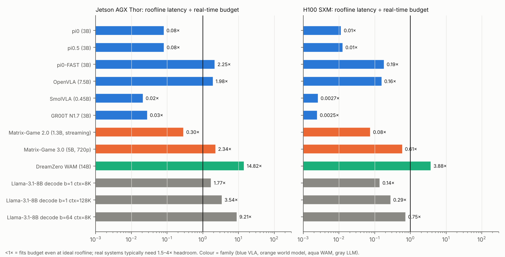
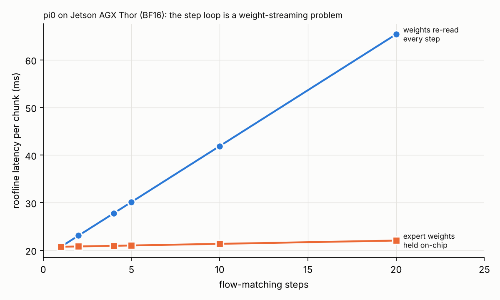

# 04 · 計算負載：FLOPs、算術強度、瓶頸在哪

每個點是一個模型的一個推論階段。H100 的 ridge 點是 295 FLOP/B、Jetson AGX Thor 約 950 FLOP/B：**點落在 ridge 左邊就是頻寬瓶頸，右邊才是算力瓶頸**。

---

## 4.1 每個推論單位的計算量

| Workload | GFLOP / 單位 | 算術強度 (FLOP/B) | 注意力佔 FLOPs | 迴圈 GEMM 的 M | 步數 |
|---|---|---|---|---|---|
| π0 | 4,371 | 382 | 4.3% | 51 | 10 |
| π0.5 | 5,017 | 437 | 4.7% | 50 | 10 |
| SmolVLA | 818 | 315 | 15.1% | 50 | 10 |
| GR00T N1.7 | 664 | 127 | 2.3% | 41 | 4 |
| π0-FAST | 4,491 | 15 | 2.3% | 1 | ~60 |
| OpenVLA | 4,119 | 38 | 0.9% | 1 | 7 |
| V-JEPA 2-AC | 1,962,593 | 6,161 | 4.7% | 206,400 | 10 CEM iters |
| Cosmos-2.5-2B action-cond | 1,514,278 | 4,800 | 27.0% | 4,800 | 35 × CFG2 |
| Cosmos-2.5-2B 720p/77f | 96,361,349 | 70,400 | **83.2%** | 70,400 | 35 × CFG2 |
| Matrix-Game 2.0 | 37,186 | 2,552 | 29.0% | 2,640 | 3 (+1) |
| Matrix-Game 3.0 | 242,166 | 7,040 | 24.3% | 7,040 | 3 |
| DreamZero | 548,248 | 3,106 | 31.3% | 3,152 | 4 (+1) |
| Llama-3.1-8B decode b=1 8K | 18.3 | 1.1 | 23.5% | 1 | – |
| Llama-3.1-8B decode b=1 128K | 82.7 | 2.6 | 83.1% | 1 | – |
| Llama-3.1-8B prefill 2K | 29,687 | 1,940 | 3.7% | 2,048 | – |

計算量橫跨 **7 個數量級**：GR00T 一個 chunk 0.66 TFLOP，Cosmos 一段 720p 影片 96 PFLOP。

## 4.2 VLA：FLOPs 少，但時間花在頻寬上

以 π0 在 Jetson AGX Thor 上為例（BF16，理想 roofline）：

| 階段 | GFLOP | 佔 FLOPs | 搬運 MB | AI | 瓶頸 | 時間 ms | 佔延遲 |
|---|---|---|---|---|---|---|---|
| ViT × 3 | 656 | 15% | 918 | 715 | 頻寬 | 3.4 | 8% |
| VLM prefill | 3,332 | 76% | 4,099 | 813 | 頻寬 | 15.0 | 36% |
| Action expert × 10 | 383 | **9%** | 6,417 | 60 | 頻寬 | 23.5 | **56%** |

**只佔 9% FLOPs 的 action expert，吃掉 56% 的時間。** GR00T 也一樣：DiT 4 步佔 21% FLOPs、64% 延遲（12.3 / 19.2 ms）；SmolVLA 的 expert 佔 12% FLOPs、67% 延遲。

原因就是 M 太小。expert 的 GEMM 是 `[51 × 1024] × [1024 × 4096]`，在 systolic array 或 tensor core 上：

- **算術強度**：AI ≈ M = 51 FLOP/B（BF16），遠低於任何現代加速器的 ridge 點（200–1000）。
- **陣列利用率**：一個 128 × 128 的 systolic array 處理 M=51 時，若以 M 為串流維度，pipeline 填充/排空的開銷相對於 51 列的有效工作非常大；若以 M 為陣列維度，則只用到 40% 的列。
- **核心啟動開銷**：每步 18 層 × 約 7 個 kernel = 126 次 launch，10 步就是 1,260 次。在 GPU 上這是 openpi 預設 `pytorch_compile_mode="max-autotune"`、而且用 `jax.lax.while_loop` 把整個迴圈編譯成一張圖的原因。

## 4.3 AR-VLA：就是 LLM decode

π0-FAST 和 OpenVLA 的 decode 階段 AI ≈ 1 FLOP/B，和 Llama decode 完全一樣：

| | π0-FAST | OpenVLA | Llama-3.1-8B |
|---|---|---|---|
| 每 token 讀的權重 | 2.0 B + 0.53 B 詞表 | 6.5 B + 0.13 B 詞表 | 7.0 B + 0.53 B 詞表 |
| Thor 上每 token | ~18 ms | ~49 ms | ~59 ms |
| 一次推論需要的 token | ~60 | 7 | – |

注意 **詞表輸出層**：Gemma 的 257,152 × 2048 矩陣是 1 GB（BF16），每個 decode 步都要讀，但 FAST 實際只用到詞表中保留給動作的一小段。這是 AR-VLA 特有的浪費：**用一個為 25 萬詞設計的 softmax 去輸出幾百種動作 token**。

## 4.4 影片世界模型：算力瓶頸，注意力是主角

- 權重被數千個 token 攤提，AI 2,500–70,000，在所有硬體上都是**算力瓶頸**。
- **注意力的佔比隨 token 數成長**：Matrix-Game 2.0（2,640 query × 5,280 key）29%，Cosmos 720p（70,400²）83%。
- 這和 LLM prefill 不同：LLM prefill 2K 的注意力只佔 3.7%，因為序列短且 causal。影片 DiT 是**全雙向（或區塊 causal）注意力 × 大量 token × 數十步重複**。
- 3D RoPE（時間 × 高 × 寬三組頻率，例如 Matrix-Game 的 `rope_dim_list: [8, 28, 28]`）、adaLN 調變（每層由時間步 embedding 產生 scale/shift/gate）、qk-norm——這些非 GEMM 運算在 FLOPs 中不起眼，但在加速器上需要專門的向量單元支援。

## 4.5 JEPA-MPC：唯一能用 batch 撐滿硬體的機器人推論

V-JEPA 2-AC 的 predictor 以 batch 400 跑 10 輪 CEM，GEMM 的 M = 400 × 516 = 206,400。AI ≈ 6,000，完全算力瓶頸。

| 硬體 | 一次規劃的理想延遲 |
|---|---|
| H100 | 2.0 s |
| Jetson AGX Thor | 7.6 s |

即使在 H100 上也達不到即時控制。V-JEPA 2 論文報告的規劃時間約為每個動作十幾秒，與本模型的量級（理想值 × 數倍實際開銷）一致。這說明「在潛在空間做大量想像」的路線，**計算需求和 VLA 是不同的數量級**；它的優勢是能用平行度換硬體效率。

## 4.6 即時性：誰能在預算內完成

| Workload | 預算 | H100 | Thor（BF16） | Thor（FP8） | Thor（FP4） |
|---|---|---|---|---|---|
| π0 | 500 ms | 5.9 | 41.9 | 20.9 | 10.9 |
| GR00T N1.7 | 667 ms | 1.7 | 19.2 | 9.6 | 4.9 |
| SmolVLA | 500 ms | 1.3 | 10.9 | 5.5 | 2.8 |
| OpenVLA | 200 ms | 32.3 | 397 | 198 | 100 |
| π0-FAST | 500 ms | 94.5 | 1,125 | 562 | 282 |
| Matrix-Game 2.0 | 480 ms / 12 幀 | 37.6 | 144 | 72 | 36 |
| Matrix-Game 3.0 | 400 ms / 16 幀 | 245 | 935 | – | – |
| DreamZero | 143 ms（7 Hz） | 554 | 2,117 | 1,058 | 529 |

（理想 roofline 下限，實際通常要乘 1.5–4。）

讀法：
- **Flow-matching VLA 在邊緣 SoC 上綽綽有餘**，連 BF16 都只用掉預算的 2–8%。這說明 VLA 的難題不是「能不能跑」，而是**頻寬利用率差、能效差**——大部分時間硬體在等 DRAM。
- **AR-VLA 在邊緣端跑不動**，是 LLM decode 的老問題。π0-FAST 的推論時間在 Thor 上是 π0 的 27 倍。
- **DreamZero 即使在 GB200 上，BF16、4 步也只有 219 ms**（理想值），論文的 7 Hz 必須靠 1–2 步取樣 + 低精度 + 系統優化才達得到——與論文的 38× 優化敘述相符。
- **即時影片世界模型**（Matrix-Game 2.0）在 Thor 上理論上可達即時，但需要約 1 GB KV cache 與 3D VAE。

## 4.7 去噪步數的影響

| 步數 | π0 on Thor（權重每步重讀） | 權重常駐片上 |
|---|---|---|
| 1 | 20.7 ms | 20.7 ms |
| 4 | 27.8 ms | 20.9 ms |
| 10 | 41.9 ms | 21.3 ms |
| 20 | 65.4 ms | 22.0 ms |

若 expert 權重能常駐片上，迴圈的**權重頻寬成本消失**——π0 在 10 步時只比 1 步多 3%。但每步的算力與串行延遲仍在；π0 的 expert 每步算力很小，所以這個案例中步數的邊際成本很低，不能推廣到每步算力較大的迴圈（例如 TD-MPC2-317M 常駐後即撞到算力上限，見 [`results/decision_system.md`](../results/decision_system.md) §3）。在這個前提下，模型層的步數蒸餾與硬體層的權重常駐可以**部分互相替代**。

> 修訂（2026-10-12）：原文「步數幾乎變成免費」措辭過強，依 GPT 的審查意見修正，見 [reviews/pre2026-llm-acceleration-review.md](../reviews/pre2026-llm-acceleration-review.md) Q3(b)。
