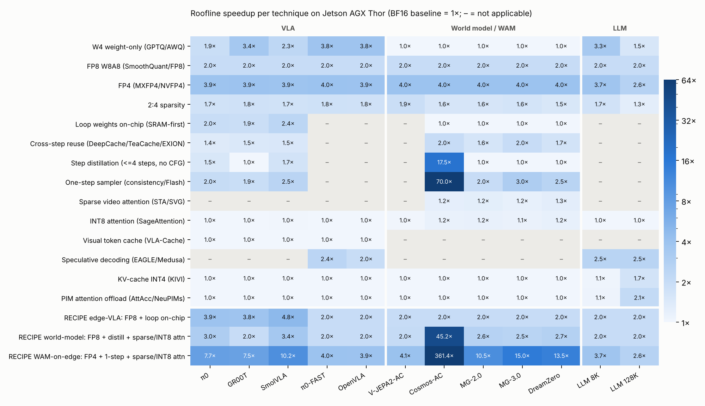

# 07 · 2026 年以前的 LLM 加速器論文與加速技巧：哪些能用在 VLA / World Model / WAM

本章回答一個問題：**過去幾年為 LLM（以及影片擴散模型）發展出來的硬體與軟體加速技巧，有哪些可以直接搬到機器人推論上，哪些不行，為什麼。**

做法是把每個技巧寫成分析模型上的一個「變換」，變換幅度取自該技巧原始論文的數字，套到 [01](01-model-catalog.md) 的 12 個 workload 上，算出 roofline 加速倍數。程式在 [`analysis/techniques.py`](../analysis/techniques.py)，完整表格在 [`results/techniques.md`](../results/techniques.md)。

---

## 7.1 結論先講

| 結論 | 依據（Thor 上的加速倍數） |
|---|---|
| **低精度是唯一對所有類別都有效的技巧** | FP8 全部 2.0×、FP4 全部 2.6–4.0× |
| **LLM serving 的「招牌技巧」對 VLA 幾乎無效** | KV INT4、PIM attention 對 VLA 都是 1.00–1.01×；PagedAttention、continuous batching 在 b=1 下無用武之地 |
| **LLM decode 的權重頻寬技巧，對 VLA 迴圈有效** | 權重量化 W4：GR00T 3.4×；權重常駐片上：SmolVLA 2.4× |
| **但權重常駐對影片世界模型無效** | Matrix-Game / DreamZero 都是 1.00×（已經是算力瓶頸） |
| **影片世界模型要靠擴散模型的技巧，而不是 LLM 的** | 跨步重用 1.6–2.0×、步數蒸餾 Cosmos 17.5×、單步 2–3× |
| **attention 專用技巧對世界模型只有中等效果** | 稀疏視訊 attention 1.2–1.3×、INT8 attention 1.1–1.2×（因為 attention 只佔 24–31% FLOPs） |
| **Speculative decoding 只對自回歸 VLA 有效** | π0-FAST 2.4×、OpenVLA 2.0×；flow VLA 不適用 |
| **視覺 token 快取在頻寬受限的邊緣端無效** | VLA-Cache 在 Thor 上 1.00×，在 H100 上 π0 1.18×——它省的是 FLOPs，不是權重讀取 |
| **組合後，DreamZero 級 WAM 在 Thor 上接近即時** | FP4 + 單步 + 稀疏/INT8 attention：13.5×，2,117 → 157 ms（預算 143 ms） |

最後一條要特別注意：它假設單步取樣不損失動作品質（DreamZero-Flash 論文宣稱如此）、FP4 不影響閉環成功率、且 Thor 的 FP4 峰值能被有效利用。這三點都尚未驗證。

---

## 7.2 硬體加速器論文

### (a) 早期 Transformer / attention 加速器（2020–2023）

| 論文 | 會議 | 核心想法 |
|---|---|---|
| A3 | HPCA'20 | 近似 attention：先找出可能有大分數的 key，只算那些 |
| SpAtten | HPCA'21 | 依累積 attention 分數做 token / head 級剪枝，漸進量化 |
| ELSA | ISCA'21 | 以雜湊近似找出相關 key，跳過不重要的 attention 計算 |
| Sanger | MICRO'21 | 先用低精度預測 attention 稀疏樣式，再重組成規則化稀疏計算 |
| DOTA | ASPLOS'22 | 輕量偵測器在執行時剔除弱 attention 連結 |
| FACT | ISCA'23 | 以 eager prediction 同時剪枝 attention 與 FFN 的計算 |

**可用性**：這類加速器假設 **attention 是瓶頸**。這對影片 DiT（Cosmos 720p attention 佔 83% FLOPs）有參考價值；對 VLA（attention 2–15%）則沒有。另外它們多半為 NLP 的短序列設計，影片的 3D 局部性（相鄰 patch、相鄰幀）其實提供了更規則的稀疏結構，後面 Sliding Tile Attention 用的正是這一點。

### (b) LLM decode 與低精度硬體（2022–2025）

| 論文 | 會議 | 核心想法 |
|---|---|---|
| DFX | MICRO'22 | 多 FPGA 的 GPT 生成加速器，專門針對 decode 階段的低延遲 |
| ANT | MICRO'22 | 自適應數值型別，讓低位元表示適應張量的值分佈 |
| Mokey | ISCA'22 | 把權重與 activation 量化成共用字典的索引，免重新訓練 |
| OliVe | ISCA'23 | outlier-victim pair 量化：犧牲 outlier 旁邊的值，讓 outlier 保有精度且記憶體對齊 |
| FIGNA | HPCA'24 | FP-INT 混合精度 GEMM 單元，針對 weight-only 量化 LLM |
| Tender | ISCA'24 | 依 channel 把張量分組，用 2 的冪次 scale 讓重新量化只需位移 |
| BitMoD | HPCA'25 | 位元串列運算 + 每組可選的低精度資料型別 |
| LUT Tensor Core | ISCA'25（arXiv 2408.06003） | 用查表做低位元混合精度 GEMM，作者宣稱運算密度與能效都提升一個數量級以上 |

**可用性：高。** VLA 的瓶頸就是「權重讀取」，任何降低每個權重位元數的硬體都直接有效（W4 weight-only：π0 1.9×、GR00T 3.4×、OpenVLA 3.8×）。

要注意兩點：
- **動作頭的精度敏感度未知**。這些論文都以 perplexity 或 zero-shot 準確率驗證，沒有一篇驗證過「量化誤差經過 10 步 ODE 積分後對軌跡的影響」。GPT/03 也強調量化必須以閉環成功率驗證。
- **影片世界模型的 weight-only 量化無效**（1.00×），因為它們是算力瓶頸；要用 W8A8 / FP8 這種連運算一起降精度的方式才有用。

### (c) PIM / 近記憶體運算（2021–2024）

| 論文 | 會議 | 核心想法 |
|---|---|---|
| Samsung HBM-PIM | ISSCC'21 / ISCA'21 | 在 HBM bank 旁放 FP16 MAC，處理記憶體受限的 GEMV |
| AttAcc | ASPLOS'24 | 把 batched decode 的 attention（讀 KV 的部分）放到 HBM-PIM，GEMM 留在 GPU |
| NeuPIMs | ASPLOS'24 | NPU + PIM 異質架構，讓 GEMM 與 GEMV（attention）在 batch 下同時執行 |
| SpecPIM | ASPLOS'24 | 為 speculative decoding 的草稿與驗證模型在 PIM/NPU 間分配工作 |
| Duplex | MICRO'24 | 同一裝置支援低算術強度（attention、MoE expert）的 PIM 路徑與高強度路徑 |
| Cambricon-LLM | MICRO'24 | 以 NAND flash + NPU 的晶片組合在邊緣端跑 70B 等級模型 |

**可用性：低（對 VLA）、中（對串流世界模型）。** PIM 主要解決的是 **KV cache 讀取**，對 LLM 128K context 有 2.1×，但 VLA 的 KV 只有 0.7–18 MB（1.00×）。

不過 PIM 的另一個用途是 **GEMV / 低 M 的 GEMM**——這正是 VLA 迴圈的形狀（M = 40–51）。現有 PIM 論文大多針對 M = 1 或小 batch 的 attention；把 PIM 用在「小 expert 的 M=51 GEMM」是一個沒人做過的方向。不過 M=51 時 AI ≈ 50，可能已超出 PIM 每 bank MAC 數能有效服務的範圍，需要評估。

### (d) SRAM 為主 / 資料流架構（產品）

| 晶片 | 關鍵規格 | 設計取向 |
|---|---|---|
| Groq TSP / LPU（ISCA'20） | **230 MB 片上 SRAM**、80 TB/s 片上頻寬、14 nm、決定性執行 | 模型權重全放 SRAM，多晶片分割；b=1 低延遲 |
| Google TPU v4（ISCA'23） | 128 MiB CMEM、光學可重組互連 | 資料中心訓練/推論 |
| SambaNova SN40L（arXiv 2405.07518） | SRAM + HBM + DDR 三層記憶體 | 資料流架構 + 多模型 composition of experts |
| d-Matrix Corsair（2024–25） | 每 package **1 GB SRAM**、128 GB LPDDR5、數位記憶體內運算、MX 格式 | SRAM 放模型做低延遲，LPDDR 做容量 |
| Cerebras WSE-3（2024） | 晶圓級，44 GB SRAM | 整個模型放片上 |

**可用性：對 VLA 迴圈很高，對影片模型低。** 這是 [06](06-asic-implications.md) 的「迴圈權重常駐片上」直接的工業先例：權重常駐讓 π0 1.96×、SmolVLA 2.39×，但 Matrix-Game / DreamZero 1.00×。

這類晶片的經驗也提醒了成本：Groq 用整片大晶粒換到 230 MB SRAM。下一節（[08](08-cross-review-with-gpt.md)）對 GPT 的質疑做了面積估算。

### (e) 擴散模型加速器（2024–2025）

| 論文 | 會議 | 核心想法 | 報告結果 |
|---|---|---|---|
| **Cambricon-D** | ISCA'24 | **差分運算**：相鄰去噪步的特徵圖很相似，只算差值（針對卷積層） | – |
| **EXION** | HPCA'25 | 跨步 FFN 重用（以 GELU 輸出的位元遮罩決定哪些值沿用上一步）+ 步內 attention eager prediction | 能效為伺服器 GPU 的 3.2–379×（作者數字） |
| **Ditto** | arXiv 2501.11211 | 相鄰時間步 activation 的餘弦相似度約 0.98；約 96% 的差值能用 4 bit 表示 | 相對基準加速器最多 1.5×、省 17.7% 能耗 |
| SD-Acc | arXiv 2507.01309 | 分階段取樣：後期只跑部分網路 + systolic array 統一處理卷積與 attention | 比 Cambricon-D 快 1.8–3.2×（同峰值條件） |

**可用性：對世界模型和 flow VLA 都很高，而且是 LLM 加速器完全沒有的能力。** 這組論文抓到的是**迭代精煉的時間冗餘**——相鄰步驟的輸入/中間值幾乎一樣。這正是 VLA 迴圈和影片 DiT 共同的結構（見 [05 §2](05-vs-llm.md)）。

一個尚未有人驗證的推論：**flow-matching 的 action expert 是否也有類似的跨步相似度？** 如果 π0 的 10 步之間 expert 中間值也有 ~0.98 的相似度，那麼差分運算可以讓每一步只讀取並計算「變化的部分」，同時處理頻寬與計算。這需要對 openpi 實際跑 profiling 才能判斷。

---

## 7.3 軟體 / 系統技巧

### (a) Attention 核心

| 技巧 | 出處 | 對誰有用 |
|---|---|---|
| FlashAttention 1/2/3 | NeurIPS'22 / ICLR'24 / NeurIPS'24 | **全部**（本研究的 activation 流量假設本來就建立在它上面） |
| FlashDecoding / FlashInfer | 2023 / 2024–25 | LLM decode；VLA 的 suffix 對 prefix cache 的 attention 也能用 |
| SageAttention 1/2 | ICLR'25 / ICML'25 | 影片 DiT（1.1–1.2×）；VLA 幾乎無效 |
| Sliding Tile Attention | 2025（FastVideo） | 影片 DiT：利用 3D 局部性的區塊稀疏 attention |
| Sparse VideoGen | ICML'25 | 影片 DiT：依 head 判斷是空間型還是時間型稀疏 |

### (b) KV cache 與 serving

| 技巧 | 出處 | 對機器人推論 |
|---|---|---|
| PagedAttention（vLLM） | SOSP'23 | **不需要**：VLA cache 固定大小、用完即丟 |
| RadixAttention / prefix caching（SGLang） | 2024 | 有限：同一機器人連續推論的 prompt 前綴相同，但影像每次都變 |
| Continuous batching（Orca） | OSDI'22 | **不需要**：b = 1 |
| Chunked prefill（Sarathi-Serve） | OSDI'24 | 不需要 |
| Prefill/decode 分離（DistServe、Splitwise） | OSDI'24 / ISCA'24 | **概念可借用**：VLA 的「prefill（算力型）」和「迴圈（頻寬型）」也可以放在不同硬體單元，同一顆晶片內的異質分區 |
| MQA / GQA / MLA | 2019 / 2023 / 2024 | 已被 VLA 採用（π0 = MQA）；影片 DiT 仍是 MHA，有改進空間 |
| StreamingLLM（attention sink）、H2O、SnapKV | ICLR'24 / NeurIPS'23 / 2024 | 串流世界模型的 KV 視窗管理可借用 |
| KIVI（KV 量化） | ICML'24 | DreamZero / Matrix-Game 的 KV 有幫助，但它們是算力瓶頸，roofline 上幾乎沒變化 |

### (c) 解碼加速

| 技巧 | 出處 | 對機器人推論 |
|---|---|---|
| Speculative decoding | ICML'23 | 只對 AR-VLA（π0-FAST 2.4×、OpenVLA 2.0×） |
| Medusa / EAGLE 1–3 | ICML'24 / 2024–25 | 同上 |
| 平行解碼（PD-VLA 等） | 2025 | AR-VLA 的動作 token 之間依賴弱，可以平行生成 |

### (d) 量化與稀疏

| 技巧 | 出處 | 對機器人推論 |
|---|---|---|
| LLM.int8 / SmoothQuant / GPTQ / AWQ | 2022 / ICML'23 / ICLR'23 / MLSys'24 | 直接可用；VLA 用 weight-only 就有效，世界模型要 W8A8 |
| QuaRot / SpinQuant（旋轉消 outlier） | NeurIPS'24 / 2024 | 可用，對 4-bit 激活很重要 |
| MX / NVFP4 格式 | OCP 2023 / Blackwell | 可用；d-Matrix、Blackwell 都已原生支援 |
| SparseGPT / Wanda（2:4） | ICML'23 / ICLR'24 | 1.5–1.9×；但動作頭剪枝未經驗證 |
| DejaVu / PowerInfer（contextual sparsity） | ICML'23 / SOSP'24 | 有潛力：每次推論只讀部分 FFN 神經元，直接降權重流量 |

### (e) 擴散 / 影片生成專用

| 技巧 | 出處 | 對機器人推論 |
|---|---|---|
| DeepCache / FORA / Δ-DiT | CVPR'24 / 2024 / 2024 | 跨步重用高層特徵 |
| PAB（Pyramid Attention Broadcast） | 2024 | 跨步重用 attention 輸出 |
| **TeaCache** | CVPR'25 | 依時間步 embedding 變化決定何時重用；**Matrix-Game 1 的 repo 已附 `teacache_forward.py`** |
| LCM / DMD2 / Consistency | 2023 / NeurIPS'24 | 步數蒸餾 |
| **Self-Forcing / CausVid** | 2025 / CVPR'25 | 因果自回歸影片 + 少步蒸餾；**Matrix-Game 2.0 就是這條路線**（3 步） |
| xDiT / PipeFusion | 2024 | 多 GPU 平行影片 DiT；資料中心用 |

### (f) 執行時開銷

| 技巧 | 出處 | 對機器人推論 |
|---|---|---|
| CUDA Graphs / torch.compile | – | **非常重要**：π0 一次推論約 1,260 次 kernel 呼叫；openpi 預設 `max-autotune` |
| Megakernel（Hazy Research 2025、Mirage MPK arXiv 2512.22219） | 2025 | 把整個推論編成一個常駐 kernel，作者報告相對 vLLM/SGLang 最多 1.7×；**對 b=1、小 M 的 VLA 迴圈特別合適**——那正是 kernel 啟動開銷佔比最大的情況 |

### (g) VLA 專用（2024–2025）

| 技巧 | 出處 | 想法 |
|---|---|---|
| **VLA-Cache** | NeurIPS'25 | 重用相鄰幀間靜態視覺 token 的 KV；OpenVLA FLOPs 1.86 → 1.36 T、RTX 4090 上 51.9 → 31.8 ms |
| **Real-Time Chunking（RTC）** | Physical Intelligence 2025 | 下一段 chunk 在當前 chunk 執行時就開始推論，以 inpainting 方式讓兩段銜接平滑 |
| FAST tokenizer | 2025 | DCT + BPE 壓縮動作序列，減少 AR 解碼 token 數 |
| SmolVLA 非同步推論 | 2025 | 推論與執行解耦 |

---

## 7.4 依類別的建議

### Flow-matching VLA（π0、GR00T、SmolVLA）

| 優先 | 技巧 | 理由 |
|---|---|---|
| 1 | 低精度權重（W4/FP8/FP4） | 直接處理頻寬瓶頸，1.9–3.9× |
| 2 | 迴圈權重常駐片上 | 1.9–2.4×，和步數無關；與 FP8 組合 3.8–4.8× |
| 3 | Megakernel / 整個迴圈編譯成一張圖 | 處理 roofline 看不到的 kernel 啟動開銷 |
| 4 | Best-of-K 候選平行 | 不是加速，而是**把閒置算力換成決策品質**（見 [`results/decision_system.md`](../results/decision_system.md)：K=16 只多 25% 時間） |
| 5 | 跨步差分運算（Cambricon-D / Ditto 想法） | 需要先 profiling 確認動作 expert 的跨步相似度 |
| 不建議 | PagedAttention、continuous batching、KV 量化、PIM attention | 結構上不適用 |

### 自回歸 VLA（OpenVLA、π0-FAST）

把它當 LLM decode：weight-only 量化（3.8×）+ speculative / 平行解碼（2.0–2.4×）。或者，直接換成 flow 架構。

### 影片世界模型與 WAM（Cosmos、Matrix-Game、DreamZero）

| 優先 | 技巧 | 理由 |
|---|---|---|
| 1 | 步數蒸餾 / 單步 | 最大槓桿；即時世界模型（Matrix-Game 2/3、DreamZero-Flash）**已經在用** |
| 2 | FP8 / FP4（W+A） | 算力瓶頸，必須連運算一起降精度 |
| 3 | 跨步重用（TeaCache / EXION） | 1.6–2.0×；與蒸餾部分重疊（步數已很少時效果下降） |
| 4 | 稀疏 / 局部 attention、INT8 attention | 1.1–1.3×；attention 佔比越高越有效 |
| 不建議 | 權重常駐片上、weight-only 量化 | 已經是算力瓶頸，1.00× |

### 潛在空間 MPC（V-JEPA 2-AC）

純算力瓶頸、可大 batch，最接近 LLM **prefill / 訓練**的特性：FP8/FP4（2–4×）與 2:4 稀疏（1.9×）有效，其餘多不適用。更大的槓桿在演算法端：減少 CEM 的候選數與迭代數，或改用 policy 提候選（GPT/03 的建議）。

---

## 7.5 LLM 加速器沒處理、但機器人推論需要的東西

把上面所有技巧套用後，仍有幾項需求在 2026 年以前的 LLM 加速器文獻中幾乎沒有對應：

1. **小 M（40–64）、固定次數、權重重複的迴圈**：LLM 文獻處理的是 M = 1（decode）或 M = 數千（prefill），中間這一段沒有人專門設計。
2. **跨步差分運算用於 Transformer 動作頭**：Cambricon-D / Ditto 做在影像擴散模型上，尚未延伸到 flow-matching 動作頭。
3. **3D 卷積 VAE 與 Transformer 共存**：LLM 加速器多半不支援卷積，擴散加速器又多半針對 U-Net。
4. **adaLN / adaRMSNorm 與時間步條件化**：每層都有由時間步產生的 scale/shift/gate，需要向量單元支援並與 GEMM 融合。
5. **多頻率、硬即時排程**：相機 30 Hz、推論 2–10 Hz、控制 50+ Hz，並要保證最壞情況延遲。LLM serving 追求吞吐，從未有這個需求。
6. **感測器直入**：相機 → ISP → ViT 的資料路徑。

這六項是本專案 ASIC 設計可以做出差異化的地方。
