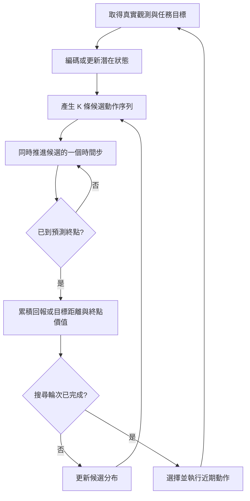

# World Model 的計算、參數、prefill/decode、權重與完整演算法

日期：2026-10-12｜作者：GPT。回答使用者的六個問題。討論部署推論；除特別註明，不含反向傳播。文獻／官方程式事實、公式推導、假設數值分開標示。數字不是模型 profiler 或晶片實測。

## 先固定三個口徑

1. **World model 是功能，不是唯一架構。** 可以用 MLP、recurrent state-space model、Transformer 或 diffusion；也可能混合。
2. **一次 forward 不等於一次決策。** 一次 forward 可能只推進一批候選的一個時間步；一次決策可能包含觀測編碼、數輪搜尋、數百條候選、各自多步 rollout。
3. **參數容量不等於流量。** checkpoint→裝置記憶體通常是啟動載入；HBM/DRAM→片上 SRAM 的權重搬移則可能每個 forward 發生。以下 MB/GB 為十進位，1 MAC=2 FLOPs。

## 1. 除了 attention block，還有哪些計算？

「attention block」可能指 attention 子層，也可能指整個 Transformer block。若指前者，同一 Transformer block 還有 FFN/MLP、normalization 與 residual；若指整個 block，還須計入感測編碼、輸入輸出投影、任務 heads 與規劃器。

| 模組 | 實際計算 | 是否必需／何時執行 |
|---|---|---|
| 觀測 encoder | CNN convolution、patch embedding、ViT、MLP；影像／狀態投影 | 取得新觀測時；不是每條想像軌跡都重新讀相機 |
| 動作與位置編碼 | 線性投影、embedding、RoPE、拼接／加法 | 使用 action conditioning 或 token 架構時 |
| FFN/MLP | 大量 GEMM、GELU/SiLU、可能 gated multiply | Transformer 每層；短序列時常是重要計算來源 |
| 狀態轉移 | MLP，或 recurrent gates、隨機 latent 分布與採樣 | 每個預測時間步；不一定存在 attention |
| 歸一化與殘差 | LayerNorm/RMSNorm/SimNorm、reduce、逐元素運算 | 視架構；FLOPs 不大仍可能影響延遲／流量 |
| reward/value/termination heads | MLP、分布轉換、softmax、ensemble 評估 | 規劃所需；JEPA 也可直接比較預測與目標 latent，不一定學 reward head |
| policy proposal | MLP／Transformer 產生動作或動作序列 | 若用 policy 引導候選或直接控制 |
| 規劃器 | 隨機採樣、裁切、累積回報、距離、top-k、均值／方差更新 | 線上 MPC；不是所有 world model 都執行 |
| pixel decoder | CNN／VAE decoder 等 | 需要生成可見影像時；latent-only 決策通常可省略 |
| diffusion/flow sampler | 重複 denoiser、時間條件、數值更新 | diffusion/flow 路線；不等於逐 token decode |

TD-MPC2 官方 `WorldModel` 明確包含 encoder、dynamics、reward、policy prior、Q ensemble，以及可選 termination；因此不能只建模 attention 成本。[S1]

對 L 層、寬度 d、FFN 寬度 4d、標準 MHA 的非 gated dense Transformer，忽略 bias/norm：

`P_stack ≈ L(4d² + 8d²) = 12Ld²`。

每個長 N 的完整序列 forward：

`C ≈ 24LNd² + 4LN²d`。

前項含 Q/K/V/output projection 與 FFN，後項為 QKᵀ 和 AV。FFN 在前項中佔 2/3；完整成本還有 softmax、norm、位置編碼等。因果遮罩、GQA、gated FFN、cross-attention、MoE 不能直接使用同一係數。

## 2. 參數量大約多少？

沒有單一典型值；至少分成 encoder、transition/predictor、reward/value/policy、可選 pixel decoder。下表是代表範圍，不是世界模型的上下界。

| 代表系統 | 公開參數口徑 | 不能混淆之處 |
|---|---|---|
| TD-MPC2 | 作者釋出的模型約 1M–317M [S2] | 是模型／agent 配置，不是單獨 dynamics；任務和輸入維度也影響實際數量 |
| DreamerV3 | 所查論文 v2 的 scaling 實驗為 12M–400M [S3] | 不同論文／程式版本的配置可能不同；不能把整個 agent 的參數都算作每步 online policy 用量 |
| V-JEPA 2-AC | ViT-g encoder 約 1B，action-conditioned predictor 約 300M，合計約 1.3B [S4] | 約 1B encoder 主要处理觀測，約 300M predictor 反覆預測；凍結權重仍要做推論運算 |

容量公式：`weight_bytes = P × bits/8`。例如 300M 參數，BF16 約 600 MB，INT8 約 300 MB，INT4 約 150 MB；後兩者尚未包含量化 scale、zero point、packing/alignment。KV、activation、workspace 不在權重容量內。1.3B BF16 原始權重約 2.6 GB，也不表示每個 rollout step 都搬移 2.6 GB。

## 3. 每次 inference 都有 prefill 和 decode 嗎？分別多少計算？

**不一定。** LLM 的 prefill 通常指計算上下文並建立 KV；decode 指使用既有 KV 逐 token 生成。不是任何「先編碼、後預測」都具有相同資料流，pixel decoder 更是另一種 decoder。

| 類型 | 合理的推論階段 | 是否可以直接套 LLM prefill/decode |
|---|---|---|
| MLP latent MPC | encode → 多候選 transition/score → 搜尋更新 | 不行；通常沒有 attention KV |
| recurrent world model＋actor | observe/update hidden state → actor | 不行；維護 recurrent state，不是標準 KV |
| token autoregressive world model | context prefill → future-token generation | 可以，但取決於模型實作與有效 cache |
| frame/block autoregressive Transformer | encode/context → 每步一批 latent tokens | 部分類似；一個「未來步」可能同時計算數百 tokens |
| diffusion/flow | condition encode → 多次 denoise → 可選像素解碼 | 不行；去噪步不等於 next-token decode |

持續運作時可以沿用合法狀態／cache，不一定每次從頭 prefill。反過來，新的動作、觀測或 mask 若改變旧表徵，不能只因歷史 token 名稱相同就重用 KV。

### LLM 式 Transformer 的解析參考

對上述非 gated MHA stack，長 N 的 prefill 有 `C_prefill≈2P_stack N+4LN²d`（完整 dense attention 基準）。若能合法使用 KV cache，生成一個 query token、可見 T 個 KV tokens：

`C_decode/token≈2P_stack+4LTd`。

因果三角形若被 kernel 跳過，prefill attention 配對數比完整 N² 少；此處故意採完整 dense 計算作清楚的比較。還未計 vocabulary head、embedding、softmax、norm；MoE/GQA 等也需重寫公式。這兩式不能用於重算整段歷史的 predictor。

**算例 B：**L=24、d=1024、FFN=4096、N=256，僅算 stack：

| 運算 | 解析 FLOPs |
|---|---:|
| 參數量 | 301,989,888 個（約 302M） |
| 256-token 完整 dense forward | 161.061 GFLOPs |
| 其中 FFN | 103.079 GFLOPs |
| 其中 attention projections | 51.540 GFLOPs |
| 其中 QKᵀ＋AV | 6.442 GFLOPs |
| 有效 KV cache 下，一個 query、T=256 | 0.629 GFLOPs |
| 將 512-token 序列全部重算 | 335.007 GFLOPs |

這是指定形狀的算例，不是 V-JEPA 2-AC 的完整推論量。雖然層數與寬度接近其 predictor，真實模型還有輸入輸出投影、不同 mask、token 數與歷史管理。**不能把 0.629 GFLOPs 的單 token decode，當成產生一整張 latent feature map 的成本。**

### 非 Transformer 的具體算例

**算例 A：簡化 MLP 規劃器。** 不是官方 checkpoint；僅借用常見的 encoder＋dynamics＋reward＋policy＋Q 結構。觀測維度64、latent512、action6，無 task embedding、termination、bias/norm 計算，也不含 policy 候選預生成。

| 模組 | 線性層形狀 | 矩陣權重數 |
|---|---|---:|
| Encoder | 64→512→512 | 294,912 |
| Dynamics | 518→512→512→512 | 789,504 |
| Reward | 518→512→512→101 | 579,072 |
| Policy | 512→512→512→12 | 530,432 |
| Q ensemble | 5 個 518→512→512→101 | 2,895,360 |
| 合計 | 不含 bias/norm／訓練用 target 複本 | 5,089,280 |

在每個線性權重每樣本使用一次的這個 MLP 算例：

- 編碼一次觀測：0.590 MFLOPs。
- 一個候選推進一步＋reward：2.737 MFLOPs。
- 一個候選終點 policy＋5 個 Q：6.852 MFLOPs。
- K=512、H=3、I=6：`C=2P_encoder+I K[H×2(P_dyn+P_reward)+2(P_policy+P_Q)]≈46.274 GFLOPs`。

I/K/H 的數值與 TD-MPC2 所查預設配置相同 [S5]，但本算例架構／完整成本不能標成官方 TD-MPC2 benchmark。真實實作還有 policy 軌跡產生、搜尋、非線性、同步等工作；大動作空間還可能增加迭代數。完整決策成本不能只報 2.737 MFLOPs。

## 4. Prefill 與 decode 各要 load 多少權重？

必須先說明哪個記憶體邊界：

| 載入路徑 | 何時發生 |
|---|---|
| SSD／主機→裝置 DRAM/HBM | 通常啟動載入一次，或模型被換出後再載入；不是每 token 讀硬碟 |
| DRAM/HBM→片上 SRAM/cache | 執行各層時；可因容量與排程多次重讀 |
| SRAM→register／運算陣列 | 即使權重常駐片上仍須供應資料；不是零成本 |

**同一 dense LLM stack 的 prefill 和每次 decode，通常都會用到各層的同一套核心權重。KV cache 省下的是歷史 K/V 重算，不是模型權重。** Prefill 可把一份權重重用於多個 token；單 token decode 的重用通常少。embedding/output head、MoE、cache residency 等另計。

在算例 B，stack BF16 權重約 **603.980 MB**。若一次 forward 的排程能把每個權重由 HBM 讀一次，且跨 forward 留不住權重：

- 256-token forward：約603.980 MB 權重流量。
- 1-token cached decode：約603.980 MB 權重流量，另加 KV 讀寫。
- 512-token 完整重算：約603.980 MB 的理想權重流量，但計算量更多。

這不是保證實際流量：tiling、有限 cache、跨 batch 重讀會增加；權重已常駐片上則减少。候選 K=512 若在同一批次共用權重，不應直接把每次權重搬移量乘512；分成多個 microbatch 且不能留住權重時，才可能隨 microbatch 數增加。

在算例 A，各階段 BF16 權重容量：

| 階段 | 所需的不同權重 | 容量 |
|---|---|---:|
| 觀測編碼 | Encoder | 0.590 MB |
| 每個 rollout 時間步 | Dynamics＋Reward | 2.737 MB |
| 終點評分 | Policy＋5個Q | 6.852 MB |
| 所有模組 | 聯集，不重複計算 | 10.179 MB |

假設每一批512候選只從外部讀每份權重一次、跨階段不能保留：一次決策的權重流量為 `0.590+6×(3×2.737+6.852)≈90.968 MB`，不是512倍。若全部權重能留在片上，冷啟動約10.179 MB；後续決策理想上可沒有新的外部權重讀取，但仍有片上供應與 activation 流量。

對 V-JEPA 2-AC 的粗略 BF16 容量分工則是 encoder 約2 GB、predictor 約0.6 GB；encoder 編碼觀測，predictor 反覆 rollout。這些是參數容量，不是已量到的每階段 bytes，且不能據此宣稱實際 cache 重用。[S4]

## 5. 是否能視為 batch=1？

**外部輸入可能是1；內部運算未必。** 至少分三個維度：

- `B_env`：同時控制多少環境／機器人；一台可為1。
- `K`：每次規劃的候選動作序列數；可能數百。
- `E`：每候選的隨機樣本或 dynamics ensemble 數；增加總工作。不同 ensemble 權重不一定能合成同一個普通 GEMM。

同一 predictor 評估獨立樣本時，有效 rollout batch 可約為 `B_env×K×E`，實際 kernel 可再拆 microbatch。Q ensemble 的模型維度與候選 batch 也要分開。

在 TD-MPC2 官方流程中，輸入先是單一觀測，encode 後再 repeat 成 `num_samples` 個狀態；預設512候選，清楚顯示 input batch 1 不等於 predictor batch 1。[S5,S6]

Transformer 就算 B=1，一幀有 N=256 tokens，線性層仍可能是 M=256 的 GEMM；不是 LLM 單 token decode 的 M=1 GEMV。多候選時線性層 M 可近似 B×K×N；attention 仍須保留候選獨立性，不能混成一條無遮罩長序列。

H 是未來時間步數，通常有依賴，不能直接當成可任意平行的 batch。對512候選、H=3、I=6 的理想批次 rollout，是每輪3次依序 transition batch、共6輪，不是9216個必須逐候選串行的呼叫；總算術工作仍對應9216個樣本轉移。

## 6. 實際演算法流程，以及與 LLM 的最大差異

### A. 線上 latent MPC：本專案的主要焦點

1. **觀測與狀態估計。** 相機、關節位置／速度等 o(t) 經 encoder 轉成 z(t)；部分可觀測系統也結合歷史 hidden state 與上一動作。目標可以是 reward、目標 latent 或任務條件。
2. **初始化規劃分布。** 對未來 H 步的動作建立均值、方差；可以把上一輪未執行的計畫向前移，作 warm start，也可由 policy 提供部分候選。
3. **抽 K 條序列。** 每條包含 a(0)…a(H−1)，限制在合法動作範圍。此時只是候選，機器尚未執行。
4. **在模型內 rollout。** 所有候選由相同 z(t) 出發，逐步計算 `z_hat(h+1)=f(z_hat(h),a(h))`，同時計算 reward、termination 或其他代價。下一步用預測 latent，不是向真實環境取新觀測。
5. **評分。** 常見形式 `J=Σ_h gamma^h r_hat(h)+gamma^H V_hat(z_hat(H))`；若預測終止需適當截斷。JEPA 類可比較預測終點與目標 latent，不必使用 reward head。風險／不確定性懲罰是可選設計，不能假定所有模型都有校準過的不確定性。
6. **更新搜尋。** 選較佳候選，以 elite 統計或加權方式更新分布，再搜尋；CEM 和 MPPI 的更新規則不完全相同。後續輪次依賴前一輪評分，不能當成全部獨立 batch。
7. **輸出動作。** 選出最佳／加權候選的近期動作；MPC 常只執行第一步，也有執行短 action chunk 的變體，不保證全部方法完全相同。
8. **觀測修正。** 動作實際執行後重新取得真實觀測，以新狀態重規劃，避免把模型的長期預測當成已發生事實。通常只有 forward 與搜尋，並非每次都反向傳播更新權重。

TD-MPC2 的官方 `act/_plan/_estimate_value` 提供這種流程的具體例子；其實作使用 MPPI、policy proposals、rollout reward 及 terminal Q。[S6]

### B. Dreamer 類：想像主要用來訓練 policy

訓練時先學 world model，再以想像軌跡訓練 actor/critic。標準部署路徑可是 `觀測→encoder→recurrent state update→actor→動作`，沒有每次都搜尋數百候選。官方 `policy()` 與訓練中的 imagination 路徑可分開辨認；特定配置仍可能含重建等額外工作。[S7]

### C. 影片生成／diffusion 類

把觀測與條件編碼後，由噪聲 latent 反覆去噪，最後可解碼成影像。其步數軸是採樣／去噪步，而不只是物理時間步。若要用來控制，還需定義動作條件與決策評分；能生成逼真影片，不代表已能可靠比較動作後果。

### 與主流自回歸 LLM 的差異

| 比較 | 主流文字自回歸 LLM | 決策型 world model 系統 |
|---|---|---|
| 條件與目標 | `p(token_next | context)` | `p(state_next | state/history, action)` 或確定性轉移 |
| 典型輸出 | 下一個語言 token | 未來狀態／特徵、reward/value；動作由規劃器或 policy 選擇 |
| 重複軸 | 輸出 token 位置 | 候選、物理時間、搜尋輪次；某些模型還有去噪步 |
| 保留內容 | 常見 KV cache | latent/recurrent state、候選軌跡與分數；Transformer 也可能有 KV |
| 閉環 | 一般生成過程未必與物理環境互動 | 控制動作改變環境，新觀測再修正狀態 |
| 重要指標 | 生成品質、token throughput／延遲 | 任務成功率、動作代價、預測可用性、deadline 與能耗 |

**最大差異是學到的條件關係及部署的回饋迴圈，不是底層乘法器。** World model 旨在預測「採取某動作後可能發生什麼」，但學得的模型不因此自動具有正確因果或物理保證。LLM 也可以建模世界或控制工具，world model 也可以是 autoregressive Transformer；分類有交集。硬體應按實際的形狀、重用、依賴與精度設計，而非依名稱判斷。

## 可重算性與限制

[解析程式](analysis/six_questions_estimates.py)重算上面的兩組例子；[輸出](results/six-questions-estimates.json)保存未四捨五入的整數數據。沒有下載 checkpoint、執行模型、量測 HBM bytes 或 PPA。要得到某個產品的確切答案，需要固定 checkpoint、輸入解析度／token 數、K/H/I、精度、cache 策略和目標硬體。

## 一手來源

- [S1：TD-MPC2 WorldModel 模組](https://github.com/nicklashansen/tdmpc2/blob/main/tdmpc2/common/world_model.py)：核對各模型子網路；main 為變動來源，查閱日2026-10-12。
- [S2：TD-MPC2 官方模型](https://www.tdmpc2.com/models)：作者釋出模型的1M–317M範圍。
- [S3：DreamerV3 論文 v2](https://arxiv.org/html/2301.04104v2)：scaling 圖6與段落列12M–400M；此處明確限定版本。
- [S4：V-JEPA 2 論文 v1](https://arxiv.org/html/2506.09985v1)：encoder規模、§3.1 predictor約300M及block-causal結構。
- [S5：TD-MPC2 配置](https://github.com/nicklashansen/tdmpc2/blob/main/tdmpc2/config.yaml)：iterations6、samples512、horizon3；實際任務可能覆寫。
- [S6：TD-MPC2 規劃程式](https://github.com/nicklashansen/tdmpc2/blob/main/tdmpc2/tdmpc2.py)：單觀測、候選複製、MPPI、評分與policy proposals。
- [S7：DreamerV3 agent 程式](https://github.com/danijar/dreamerv3/blob/main/dreamerv3/agent.py)：policy與訓練imagination路徑；查閱日2026-10-12。
