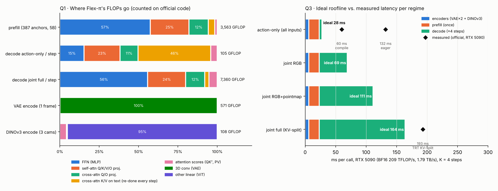

# Flex-π 深入研究：6 個問題的逐題回答

作者：Claude｜日期：2026-10-12｜研究對象：[Flex-π](https://github.com/MaSuo1032/flex-pi)（fork 自 geyan21/flex-pi，commit `20c1b2b`，論文 [arXiv 2608.10860](https://arxiv.org/abs/2608.10860)）

Flex-π 是一個 **60 億參數的 World Action Model**（華盛頓大學 + Allen AI）。它以 Wan-2.2-5B 影片模型為主幹，用 Mixture-of-Transformers 同時去噪四種串流：未來 RGB、3D 點雲圖、DINOv3 語意、機器人動作。同一份權重可以在執行時選擇要生成哪些串流：只出動作（RTX 5090 上約 60 ms）到全部一起生成（約 193 ms）。

## 證據等級

| 標記 | 意思 |
|---|---|
| **【程式碼】** | 直接讀自 Flex-π 原始碼或 config |
| **【計數】** | 在 meta 裝置上建構官方模組、執行官方推論函式，以 PyTorch `FlopCounterMode` 精確計數（[`analysis/flexpi_flops.py`](analysis/flexpi_flops.py)）。不需要權重，數到的是 GPU 實際會執行的乘加 |
| **【官方實測】** | Flex-π 文件公布的 RTX 5090 延遲（`docs/INFERENCE_OPTIMIZATION.md`） |
| **【解析】** | 由計數結果加上硬體規格推算的 roofline 時間（[`analysis/flexpi_regimes.py`](analysis/flexpi_regimes.py)） |

所有數字以官方 RoboTwin / YAM 三相機設定為準：384×320 T 形拼接畫面、3 個 latent 幀（1 個已觀測 + 2 個未來）、32 步動作、K=4 去噪步。完整表格：[`results/flexpi_regimes.md`](results/flexpi_regimes.md)、[`results/flexpi_flops.json`](results/flexpi_flops.json)。



---

## Q1 · 除了 attention 區塊以外，還有哪些計算？

**結論：Flex-π 的計算有 94% 以上是線性層（FFN + 各種投影），attention 分數本身只有 1.6–5.3%。另外兩個大宗是 3D 卷積 VAE 編碼，以及每一步都在重算的文字 cross-attention K/V。**

### 每個 Transformer 區塊內部【程式碼】

每層 DiT 區塊（`wan_video_dit.py::DiTBlock`，主幹與動作專家結構相同、寬度不同）依序做：

1. **adaLN 調變**：由去噪時間步產生 6 組 shift / scale / gate。Flex-π 設定 `seperated_timestep: true`，所以**每個 token 有自己的時間步**（已觀測錨點固定 t=0，未來 token 用當前雜訊等級），adaLN 參數是逐 token 計算的。
2. LayerNorm
3. **Self-attention**：Q/K/V 投影 → Q、K 各做 RMSNorm（qk-norm）→ **3D RoPE** → attention → O 投影
4. **Cross-attention 看文字**：Q 來自 token，K/V 來自 129 個文字 + 本體感測 context token
5. **FFN**：Linear → GELU → Linear（主幹 3072→14336→3072；動作專家 1024→4096→1024）
6. 帶 gate 的殘差相加

### FLOPs 去向【計數】

| 階段 | 總 GFLOP | FFN | Self-attn 投影 | Cross-attn Q/O | **Cross-attn K/V（文字）** | **Attention 分數** |
|---|---|---|---|---|---|---|
| Prefill（387 錨點 × 5B 主幹） | 3,563 | 57% | 25% | 12% | 4% | **1.6%** |
| Decode 只出動作（每步） | 105 | 15% | 23% | 11% | **46%** | 4.1% |
| Decode 全串流（每步） | 7,360 | 56% | 24% | 12% | 3% | **5.3%** |

### Transformer 以外的計算【程式碼 + 計數】

| 元件 | 何時執行 | 計算量 | 備註 |
|---|---|---|---|
| **Wan2.2 VAE 編碼（3D 卷積）** | 每次呼叫 2 次（RGB、點雲） | 571 GFLOP × 2 | 佔只出動作模式總 FLOPs 的 **22%**，是純卷積負載 |
| **DINOv3 ViT-B/16** | 每次呼叫 1 次（3 相機 × 224²） | 108 GFLOP | 凍結權重；輸出 14×14 → 2×2 摺疊成 7×7、3072 維 |
| 深度 → 點雲反投影 | 每次呼叫 | 很小 | 用相機內參把深度轉成 xyz，再正規化 |
| 串流投影器 / 輸出頭 | 每步 | 很小 | DINO、點雲、動作各自的 in / out 線性層 |
| Flow-matching 取樣器 | 每步 | 很小 | Euler 更新；第一幀每步重新寫回觀測值（frame-0 reclamp） |
| umT5 文字編碼器 | **不執行** | 0 | 使用預先算好的文字 embedding 快取（`load_text_encoder: false`） |
| **VAE 解碼** | **不執行** | 0（若執行為 20,884 GFLOP） | 出動作時預測的未來畫面只停留在 latent 空間；推論路徑裡沒有任何 `vae.decode` 呼叫 |

### 兩個從計數中發現的浪費

1. **文字 K/V 每步重算**：只出動作模式每一步有 46% 的 FLOPs 在把同樣 129 個 context token 重新投影成 K/V，而它們在 4 步之間不會改變。不過這段 decode 在 5090 上受頻寬限制（見 Q4），所以省下 FLOPs 本身不會縮短延遲。真正能省的是這些投影權重的讀取（每步約 0.38 GB，佔 decode 流量的 18%）。
2. **Prefill 最後一層的 post-block 白算**：prefill 只需要各層的 K/V，但第 30 層的 cross-attention + FFN 仍被計算，約佔 prefill 的 1/30。

---

## Q2 · 參數量大約多少？

**結論：推論時實際載入約 6.26B 參數（BF16 約 12.5 GB）。其中 5.00B 是視覺主幹、1.02B 是動作專家。**

| 元件 | 參數量【計數】 | 推論時是否使用 |
|---|---|---|
| 視覺主幹（Wan2.2-5B，30 層 × 3072） | **4,999,787,712** | 是（prefill；生成畫面時每步也用） |
| ├ 30 個區塊 | 4,909,701,120（每層 163.7M） | |
| │　├ FFN | 88.1M / 層（54%） | |
| │　├ Self-attention | 37.8M / 層（23%） | |
| │　└ Cross-attention | 37.8M / 層（23%） | |
| └ 嵌入 / 輸出頭 / 時間與文字 embedding | 90M | |
| 動作專家（30 層 × 1024，attention 寬 3072） | **1,020,900,366** | 是（每步） |
| └ 每層 | 33.6M（FFN 8.4M、self 12.6M、cross 12.6M） | |
| DINOv3 ViT-B/16 | 85.6M | 是（凍結） |
| Wan2.2 VAE 編碼器 | 149.6M | 是（凍結） |
| Wan2.2 VAE 解碼器 | 555.1M | **否**（出動作不需要） |
| umT5 文字編碼器 | 約 5.7B（依權重檔大小估計，未計數） | **否**（使用快取） |

驗證：TensorRT KV-split 引擎的大小【程式碼註解】是 prefill 引擎約 9.5 GB（內含主幹）、decode 引擎約 11.9 GB（主幹 + 動作專家），和 5.0B / 6.0B × 2 bytes 吻合。

一個值得注意的設計：動作專家的隱藏寬度只有 1024，但 attention 寬度是 24 heads × 128 = **3072**，和主幹相同。這樣動作 token 才能直接和視覺 token 的 K/V 一起做 attention。代價是動作專家每層的 self-attention 參數（12.6M）比 FFN（8.4M）還多，和一般 Transformer 以 FFN 為主的比例相反。

---

## Q3 · 每次推論也有 prefill 和 decode 嗎？各自計算量多少？

**結論：有，而且是 Flex-π 程式碼裡明確的分工。但這裡的 decode 不是逐 token 自回歸，而是「對一組固定的雜訊 token 做 K=4 次去噪」。**

### 結構【程式碼】

- **Prefill（每次呼叫一次）**：已觀測的第一幀錨點共 **387 個 token**（RGB 120 + DINO 147 + 點雲 120），經過 5B 視覺主幹 30 層，把每層的 K/V 存起來。這些錨點只看彼此、時間步固定為 0，所以它們的 K/V 與去噪步無關，算一次就夠（`mot.prefill_video_cache`、TensorRT `prefill_core`）。
- **Decode（K=4 步）**：只計算帶雜訊的 token，每一步都讀取 prefill 的 K/V（`mot.forward_action_with_video_cache`、`mot.decode_joint_noisy`、TensorRT `decode_core`）。要算哪些 token 取決於推論模式：

| 推論模式 | 每步雜訊 token | 走哪個網路 |
|---|---|---|
| 只出動作 | 32 個動作 token | 1B 動作專家 |
| 生成 RGB | 240 個未來 RGB + 32 個動作 | 5B 主幹 + 1B 專家 |
| 生成 RGB + 點雲 | 480 + 32 | 同上 |
| 全串流 | 774（RGB 240 + DINO 294 + 點雲 240）+ 32 | 同上 |

### 計算量【計數】與延遲【解析 vs 官方實測】

| 推論模式 | 編碼器 | Prefill | Decode 每步 × 4 | **每次呼叫合計** | 5090 理想延遲 | 官方實測 | 理想 ÷ 實測 |
|---|---|---|---|---|---|---|---|
| 只出動作 | 1,250 | 3,563 | 105 × 4 | **5.2 TFLOP** | 27.7 ms | 60 ms（compile） | 46% |
| 生成 RGB | 1,250 | 3,563 | 2,410 × 4 | **14.5 TFLOP** | 69.1 ms | – | – |
| 生成 RGB + 點雲 | 1,250 | 3,563 | 4,609 × 4 | **23.2 TFLOP** | 111.2 ms | – | – |
| 全串流（KV 分拆） | 1,250 | 3,563 | 7,360 × 4 | **34.3 TFLOP** | 163.9 ms | 193 ms（TensorRT） | **85%** |
| 全串流（錨點每步重算） | 1,250 | – | 10,923 × 4 | **44.9 TFLOP** | 215 ms | 230 ms（TensorRT 單引擎） | **93%** |

（單位：GFLOP。RTX 5090 以 BF16 209 TFLOP/s、1.79 TB/s 計。）

讀法：

- **全串流的實測達成率是 85–93%**，代表這些計數與真實執行高度吻合，而且 TensorRT 幾乎把 5090 的算力用滿。
- **只出動作的達成率只有 46%**。原因是 decode 只有 32 個 token（M=32），受頻寬限制，加上 kernel 啟動開銷，這和 CLAUDE/09 的陣列利用率分析一致。
- **KV 分拆的效益**：省下每步重算 387 個錨點，理想值從 215 降到 164 ms；官方實測從 230 降到 193 ms。
- **對照 LLM**：Llama-3.1-8B 的 prefill（2K token）約 29.7 TFLOP，decode 每 token 只有 0.018 TFLOP，但要做幾百上千次。Flex-π 每次 decode 動輒數 TFLOP，但只做 4 次。

---

## Q4 · Prefill 要載入多少權重？Decode 呢？

**結論：Prefill 載入 5B 主幹約 9.8 GB。只出動作的 decode 每步載入 1B 專家約 2.0 GB；全串流 decode 每步要載入主幹加專家約 11.8 GB，4 步共 47 GB。**

| 階段 | 權重（BF16） | K/V 流量 | 每次搬運 | 次數 | 算術強度（FLOP/B） | 5090 | Thor* |
|---|---|---|---|---|---|---|---|
| 編碼器（VAE ×2 + DINOv3） | 0.77 GB | – | 0.77 GB | 1 | 1,624 | 算力受限 | 算力受限 |
| Prefill | **9.82 GB** | 寫入 143 MB | 9.96 GB | 1 | 358 | 算力受限，17.0 ms | **頻寬受限**，36.5 ms |
| Decode 只出動作 | **2.02 GB** | 讀 76 MB（只有中間 16 層讀錨點） | 2.09 GB | 4 | **50** | **頻寬受限**，4.7 ms | 頻寬受限，30.7 ms |
| Decode 全串流 | **11.84 GB** | 讀 143 MB | 11.98 GB | 4 | 614 | 算力受限，140.9 ms | **頻寬受限**，175.5 ms |

每次呼叫合計：只出動作 **19.1 GB**、全串流 **58.6 GB**。

\*Thor：BF16 峰值為推導估計值 259 TFLOP/s、273 GB/s（見 CLAUDE/docs/00）。

重點：

- **錨點 K/V 很小**（143 MB），遠小於權重。Flex-π 和 VLA 一樣，KV cache 不是瓶頸；它和 LLM 長 context 的 17 GB 完全不同量級。
- **只出動作的 decode 每 byte 只做約 50 次運算**，和 π0 的動作專家（約 60）幾乎一樣，是典型的「小模型反覆讀權重」問題。
- **全串流在邊緣端是頻寬問題**：每步 12 GB 權重，在 273 GB/s 的 Thor 上單是讀權重就要 44 ms，4 步共 175 ms。12 GB 不可能放進晶片 SRAM，只能靠 FP8 / FP4（流量減半或減到 1/4）或減少步數。

---

## Q5 · 可以把 Flex-π 視為 batch = 1 的模型嗎？

**結論：在請求層級是，而且程式碼強制如此；但在硬體計算層級，只有「只出動作的 decode」行為接近小 batch，其餘階段都是大 M 的矩陣運算。**

- **請求層級 = 1【程式碼】**：`infer_action` 明確檢查 `input_image.shape[0] == 1`，不符合就報錯。一台機器人一次一個請求，沒有跨請求批次。
- **硬體層級的 M（每次矩陣乘法同時處理的列數）**：

| 階段 | M | 行為 | 128×128 WS 陣列利用率 | 16 × 32×32 + 可切換 dataflow |
|---|---|---|---|---|
| Prefill | 387 | 類似 LLM prefill | 50% | 91% |
| Decode 只出動作 | **32** | 類似小 batch decode（頻寬受限） | **7%** | 81% |
| Decode 全串流 | 774（主幹）+ 32（專家） | 類似大 batch | 66% | 95% |

（陣列利用率來自 CLAUDE/09 的 SCALE-Sim 校準模型，套用 Flex-π 的實際 GEMM 形狀。）

所以 batch=1 帶來的影響主要在系統層面：

- 無法跨使用者攤提權重讀取。
- 4 個去噪步必須依序執行。
- 有硬性的控制週期。
- 只出動作的 decode 卡在權重頻寬與小 M 陣列利用率。

---

## Q6 · 實際運作時的演算法流程，以及和 LLM 最大的差異

### 一次 `infer_action` 呼叫的完整流程【程式碼】

```
輸入：3 台相機 RGB（拼成 384×320 T 形畫面）、各相機深度、相機內參、
      本體感測（14 維）、預先算好的文字 embedding（128 token）

─── 準備條件 ───────────────────────────────────────────────
1. 文字 context：128 個文字 embedding + 1 個本體感測 token = 129 個 context token
   （文字 embedding 預先算好，不跑 umT5）
2. RGB 第一幀 → Wan2.2 VAE 編碼（3D 卷積）→ 48 通道、24×20 latent
   → 1×2×2 patchify → 120 個 RGB token
3. 深度 + 內參 → 反投影成 xyz 點雲 → 正規化 → 用同一個 VAE 編碼 → 120 個點雲 token
4. 3 台相機各自 → DINOv3 ViT-B/16（224²）→ 14×14×768 → 2×2 摺疊 → 7×7×3072
   → 147 個 DINO token
5. 各串流經過自己的投影器，進入 3072 維共享空間

─── Prefill（一次）──────────────────────────────────────────
6. 387 個錨點 token（t=0）通過 5B 主幹 30 層：
     第 0–6 層、第 23–29 層（HBridge 外圈）：每個子串流只看自己
     第 7–22 層（中間 16 層）：三個子串流互相看
     每層都對 129 個 context token 做 cross-attention
   每層的 K/V 存起來（30 層 × 387 token × 3072 × 2，共 143 MB）

─── Decode（K = 4 步 Euler 積分）───────────────────────────────
7. 初始化：動作 latent ~ N(0, I)，形狀 32 × 14；
   若此模式要生成畫面，未來的 RGB / DINO / 點雲 latent 也從雜訊開始
8. 對每一步 t（動作排程 shift = 1，視覺串流 shift = 6）：
     a. 動作 token 通過 1B 動作專家；生成畫面時，未來視覺 token 同時通過 5B 主幹
     b. Attention 是單向的：動作看得到視覺，視覺看不到動作
        - 中間 16 層：讀取錨點 K/V + 本步新算的 K/V
        - 外圈 14 層：動作只看自己
     c. 輸出速度 v（DINO 串流改為直接預測乾淨特徵 x0，再換算成速度）
     d. Euler 更新：x ← x + Δt · v
     e. 第一幀重新寫回觀測值（reclamp）
     f. （可選）step-skip：若連續兩步預測的餘弦相似度夠高，就跳過下一次前向計算

─── 輸出與執行 ─────────────────────────────────────────────
9. 輸出 32 步動作（未來畫面 latent 預設丟棄，不做 VAE 解碼）
10. 機器人執行 replan_steps 步（RoboTwin / YAM：32 步全部開迴路執行；LIBERO：10 步）
11. 讀新觀測，回到 1
```

推論模式由三個執行期旗標決定：`joint_video`、`joint_dino`、`joint_pointmap`，再加上輸入端的 `present_*`。共有 56 種組合，同一份權重全部支援，只是第 8 步要算哪些 token 不同。

### 和 LLM 最大的差異

**一句話：LLM 是「一次生一個 token，上下文越來越長」；Flex-π 是「看一次當下的世界（prefill），再對一整段未來動作（加上可選的未來畫面）同時去噪 4 次，然後把整段動作交給機器人執行」。**

| 面向 | LLM（例：Llama-3.1-8B） | Flex-π |
|---|---|---|
| Decode 的單位 | 1 個 token | 一整段：32 個動作，加上可選的 774 個未來視覺 token |
| Decode 次數取決於 | 輸出長度（數百～數千），壓不掉 | 去噪步數，固定為 4（論文：K ≥ 2 時成功率與最佳值差距在 1 點以內） |
| 每次 decode 處理的 token | 1 | 32（只出動作）～ 806（全串流） |
| 每次 decode 的計算 | 0.018 TFLOP | 0.1 ～ 7.4 TFLOP |
| 權重讀取 | 每 token 讀一次全部 15 GB | 只出動作每步 2 GB；全串流每步 12 GB |
| KV cache | 隨對話增長，8K ≈ 1 GB、128K ≈ 17 GB | 固定 143 MB，每次呼叫重建 |
| 輸出空間 | 離散詞彙 | 連續動作（14 維 × 32 步），同時預測未來的 RGB、幾何與語意 |
| 生成方式 | 自回歸抽樣 | Flow matching：對所有 token 同時做 ODE 積分 |
| Transformer 以外 | 幾乎沒有 | 3D 卷積 VAE、DINOv3、深度反投影 |
| 時間要求 | 吞吐量導向 | 閉迴路控制：每次呼叫產生 32 步動作，必須在下一次重新規劃前完成 |
| 算力彈性 | 大致固定 | 同一份權重可在 60 ms（只出動作）與 193 ms（全串流）之間切換 |

---

## 對加速器設計的含義

| 發現 | 依據 | 含義 |
|---|---|---|
| 只出動作的 decode 每 byte 只做約 50 次運算、M=32 | Q4、Q5 | 和 π0 相同的小 M 頻寬問題。動作專家（2 GB BF16，1 GB FP8，0.5 GB FP4）可能值得常駐片上，並搭配小陣列 |
| 全串流 decode 每步讀 12 GB 權重 | Q4 | 邊緣端是頻寬受限，FP8 / FP4 與高頻寬記憶體是關鍵；SRAM 常駐不可行 |
| VAE 編碼佔只出動作模式 22% 的 FLOPs | Q1 | 晶片需要卷積支援，或交給另一個單元處理 |
| 文字 K/V 每步重算 | Q1 | 編譯器 / 硬體應把 cross-attention 的 K/V 視為常數快取 |
| Prefill / decode 已明確分拆 | Q3 | 和 LLM 的 prefill / decode 分離概念相同，但兩者都在同一顆晶片上、每次呼叫都要做 |
| 內建 step-skip（DreamZero 式） | Q6 | 跨步相似度判斷可以做成硬體支援的提前跳出 |
| 錨點 K/V 只有 143 MB | Q4 | 可以完全放在片上 |

## 尚未驗證

- 所有延遲推算都基於官方延遲數字與計數，**沒有在本研究中實際執行 Flex-π**（需要下載 checkpoint、Wan2.2 與 DINOv3 權重，約 20 GB 以上，建議 A100 / RTX 4090 以上）。
- 官方 benchmark 腳本 `scripts/inference_opt/benchmark_flex_latency.py` 可以在 GPU 上量測各推論模式，例如：
  `python scripts/inference_opt/benchmark_flex_latency.py --ckpt <ckpt> --joint-video false --joint-dino false --joint-pointmap false --torch-compile --num-inference-steps 4`
- 文字 K/V 快取、prefill 最後一層省略這兩項優化的實際效益尚未量測。
- 5090 BF16 峰值採 209 TFLOP/s（FP32 累加）。若 TensorRT 使用 FP16 累加路徑（419 TFLOP/s），實際達成率約為上表的一半。
